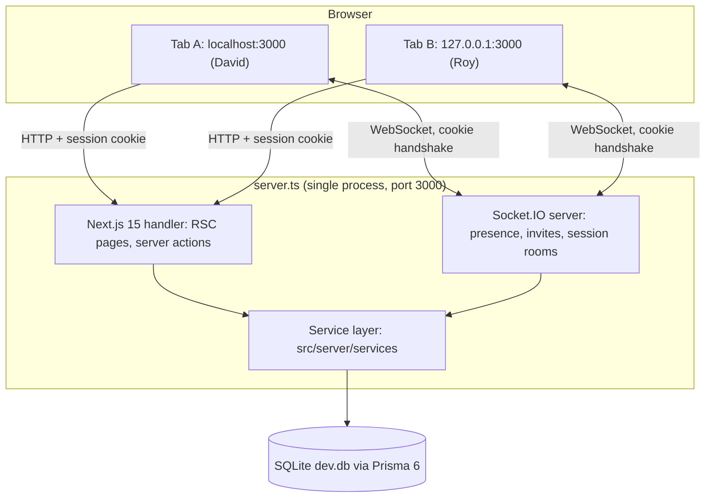
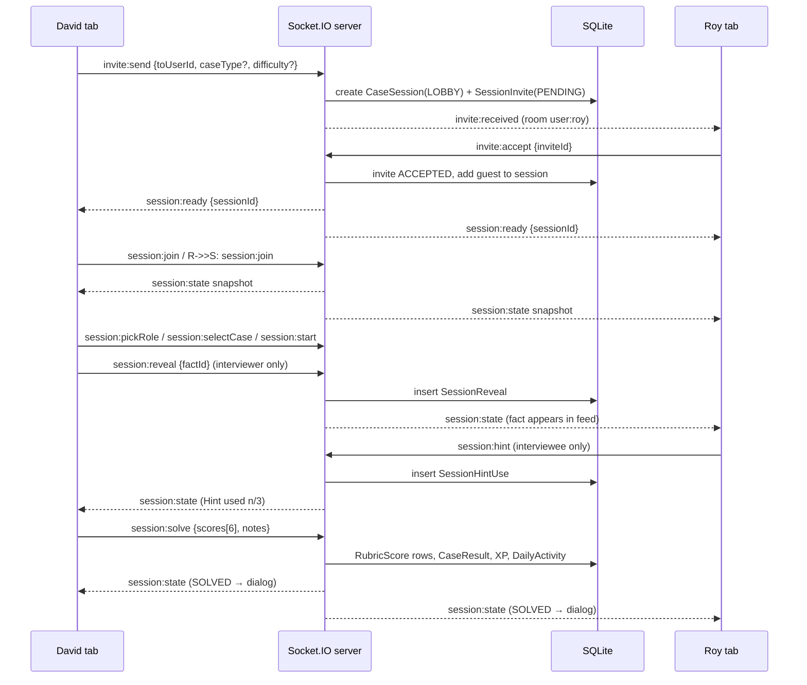
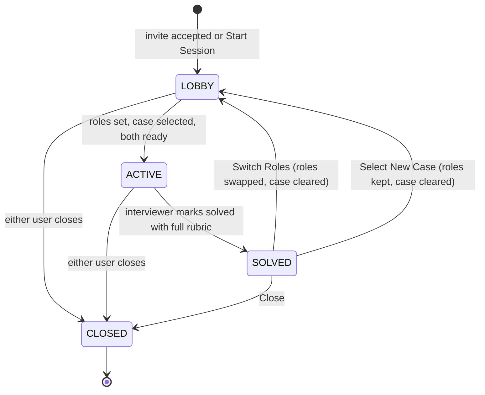
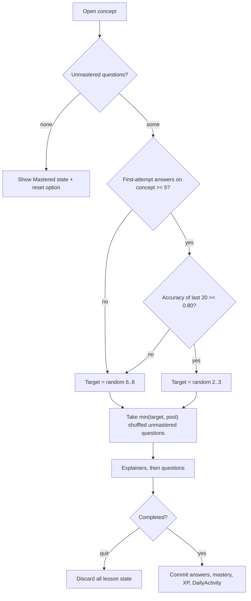
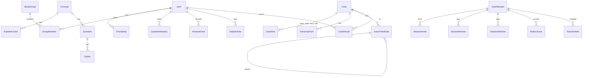
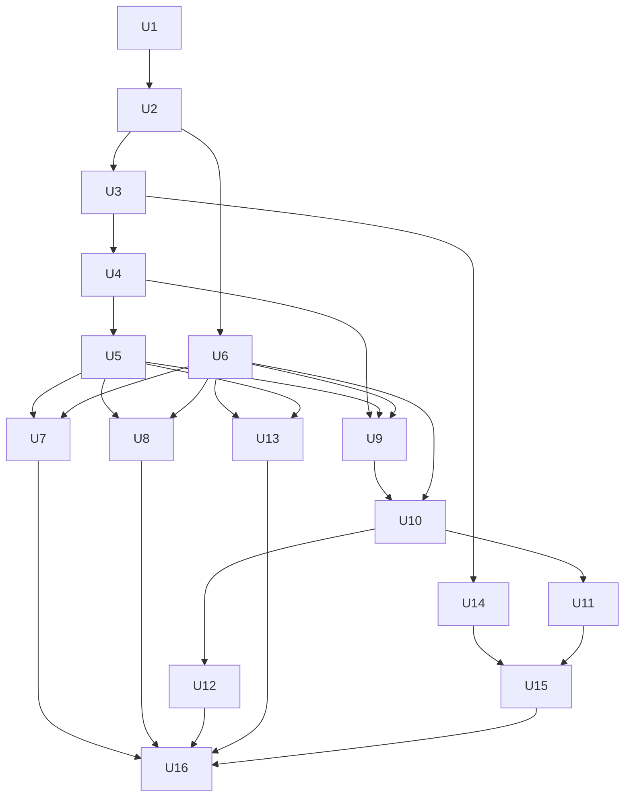

# lowercase Case Prep App - Plan

## Goal Capsule

- **Objective:** On a fresh clone, a developer can run `npm install` and one command, log in as `davidsathyandevice`, and practise consulting cases end to end. That covers the gamified Learn track and a live Interviewer/Interviewee case with a friend opened in a second tab of the same browser, then reviewing progress and editing content in the admin CMS.
- **Means:** One Next.js 15 App Router app served by a custom Node server that also hosts Socket.IO, with Prisma on SQLite as the single source of truth (KTD1, KTD2, KTD3).
- **Authority hierarchy:** Product Contract requirements (R-IDs) win on behaviour. Key Technical Decisions (KTD-IDs) win on mechanism within those requirements. Implementation Units carry unit-local detail only and override neither.
- **Execution profile:** Greenfield build in an empty folder that is not yet a git repository. Build units in dependency order (see Sequencing). Pure rule logic is unit-tested with Vitest. Two-user realtime flows are proven with Playwright using two isolated browser contexts. An E2E scenario that crosses into a page owned by a later unit (for example joining into `/session/<id>` before U10 exists) is written with its unit but enabled once that later unit lands. All of them must pass by U16.
- **Stop conditions:** Stop and ask if a requirement here proves infeasible with the chosen stack, if co-hosting Next dev and Socket.IO on one port cannot be made to work (fallback in Risks), or if the Mumbai seed content needs to leave this machine (see Risks, content licence).
- **Who finishes:** The executor (`ce-work` or a human) completes all units. The run ends when every row of the Verification Contract passes and the production server is running locally (R35).

---

## Product Contract

### Summary

Build "lowercase", a dark-mode, Brilliant-style case-prep web app with two tracks on the home page: a Learn track of adaptive concept quizzes, and a live peer case session. In the session one friend interviews the other using an admin-authored case with revealable facts, hints, a blue/grey issue tree, a transcript and a rubric. Around those tracks sit friends and study groups with live presence, progress gates by difficulty, a "You" analytics page, account settings, and an admin CMS that can author any concept, quiz, case or issue tree. Production email signup and OAuth are deferred. Login is a passwordless test flow built behind an abstraction that a real provider can replace.

### Problem Frame

Consulting candidates prepare in two disconnected ways: studying frameworks alone (Profit = Revenue − Cost, Porter's 5 Forces, VRIO, 4Ps, 3C-1P) and running mock cases with a partner from a PDF casebook. Casebook cases such as the Consult Club "Diagnostic Center – Mumbai" case already come in a structured shape: problem statement, case facts, interviewee notes, an issue tree with the correct path highlighted, recommendations, observations and a full transcript. Reading that shape from a PDF loses most of its value in a live mock. The interviewer can't reveal facts one at a time, the candidate can't get a nudge without seeing the answer, and nobody records how the candidate scored. The owner (`davidsathyandevice`) wants one place where frameworks are drilled until mastered and casebook cases run live with a friend, with enough gamification (XP, streaks, leagues) to keep both habits going. The owner also needs to author new content without touching code.

### Actors

- A1. Learner: any signed-in user. Takes Learn lessons, invites friends, plays either case role, views own analytics.
- A2. Interviewer: the session participant who sees the full case (facts, tree, transcript, rubric) and controls reveals and scoring.
- A3. Interviewee (candidate): the session participant who sees only the problem statement, revealed facts, a private notepad and the "I'm Stuck" nudge.
- A4. Admin: `davidsathyandevice` only in this phase. Holds every Learner capability plus the `/admin` CMS and testing toggles.
- A5. Peer tester: a seeded friend account (Roy C, Mihaela D or Ankit S) opened in a second tab to exercise the realtime flows against A4.

### Key Flows

- F1. Live case with a friend
  - **Trigger:** A1 clicks `[Start Session]` on an online friend (home quick-start, Track 2, or `/friends`).
  - **Actors:** A1, A5 (or any friend), then A2/A3
  - **Steps:** Invite appears instantly on the friend's screen → friend clicks `[Join]` → both land in the session lobby → each picks a role → a case is chosen from the gated pool → interviewer reveals facts while the interviewee works and may press `[I'm Stuck 💡]` → interviewer scores the rubric and clicks `[Mark Case Solved]` → both see the completion dialog → `[Switch Roles]`, `[Select New Case]` or `[Close]`.
  - **Covered by:** R15, R16, R17, R18, R19, R20, R21, R22, R23, R24, R25
- F2. Learn lesson
  - **Trigger:** A1 opens a concept node from the home Learn path or `/learn`.
  - **Actors:** A1
  - **Steps:** Explainer cards with `[Continue]` → adaptive number of unmastered questions → `[Check]` per question with correct/incorrect states → completion screen commits XP, mastery and streak. Quitting midway discards everything.
  - **Covered by:** R10, R11, R12, R13
- F3. Author a case
  - **Trigger:** A4 clicks `[+ New Case]` in `/admin`.
  - **Actors:** A4
  - **Steps:** Fill metadata and ordered lists → build the issue tree on the canvas and mark correct-path nodes → save → the case appears in the gated pool for its type and difficulty.
  - **Covered by:** R29, R30

### Requirements

**Platform and authentication**
- R1. The app uses Next.js 15 (App Router, TypeScript strict), Tailwind CSS, Framer Motion, Lucide icons, `@xyflow/react`, `recharts`, Zustand, and Prisma with SQLite.
- R2. `/login` offers a username field pre-filled with `davidsathyandevice` and a one-click `[Continue as davidsathyandevice (User + Admin)]` button. That account (David Sathyan, davidsathyandevice@gmail.com) has full Learner and Admin access.
- R3. `/login` offers `[Open as Online Friend / Peer Tester]`, which opens a second tab signed in as a seeded friend (choice of Roy C, Mihaela D, Ankit S). Both identities stay signed in at the same time in one browser (mechanism: KTD4).
- R4. Identity resolution, session issuance and route protection live behind one auth module and one `AuthProvider`. Replacing the test login with email signup or OAuth later changes only that module, not UI components.

**Shell and design system**
- R5. Dark visual system: background `#0B0C10`, card surface `#14161D` with `1px solid #262936` borders, emerald `#22C55E` for correct/progress/active, royal blue `#1D4ED8`/`#3B82F6` for correct issue-tree paths, amber `#F59E0B` for incorrect/hint/streak. Layout and component rhythm follow Brilliant's structure (see `UI/Screenshot 2026-10-15 115925.png`).
- R6. A sticky top bar shows the `lowercase` wordmark and the tabs `Home`, `Learn`, `Friends & Groups` and `You`, plus `Admin CMS` for admins only. On the right sit a streak pill, an XP pill, an online-status badge reflecting the user's own realtime connection, and a hamburger menu with `Settings`, `Account`, `Admin Panel` (admins only) and `Log out`.

**Home dashboard (`/`)**
- R7. The left column shows `Welcome, <FirstName>!`, then a streak card with Mon–Sun lightning bolts for the current week. Below it is a league card ("LITHIUM LEAGUE — Top 15 advance — N days left") with a `[Global League]` / `[My Study Groups]` toggle. Last is an online-friends card listing friends who are online right now, with a pulsing green badge and `[Start Session]` on each.
- R8. Track 1, "Learn", renders every published concept from the CMS, in admin-defined order, as a vertical path of level nodes with completion rings, a progress bar and XP earned.
- R9. Track 2, "Start a Case Session", lets the user pick a problem type (Profitability, Revenue Growth, Market Entry, Pricing, M&A) and a difficulty (Level 1 Easy, Level 2 Medium, Level 3 Hard). Locked difficulties display as locked per R25. `[Start Session]` opens a lobby immediately, with no warm-up gate.

**Learn track (`/learn`, `/learn/[conceptId]`)**
- R10. A lesson shows the concept's explainer cards in order, each with `[Continue]`, then a randomized mix of that concept's concept questions and application (case-identification) MCQs.
- R11. Lesson chrome includes a segmented green progress bar, a live XP counter and an `[X]` control that opens "Are you sure? If you quit, you will lose your progress and XP" with `[Keep learning]` and `[Quit]`. After `[Check]`, a correct answer shows an emerald glow, a +15 XP animation and `[Why?]` + `[Continue]`. An incorrect answer shows an amber glow, `[See Answer]` / `[Try Again]` and the `[Why?]` explanation.
- R12. A question answered correctly is marked mastered for that user and never served to them again. Settings (own data) and Admin (any concept) can reset mastery.
- R13. Lesson length adapts to the user's recent first-attempt accuracy on that concept: 6–8 questions while it is below 80%, 2–3 once it is at or above 80%. A lesson with unmastered questions remaining always contains at least one.

**Friends and groups (`/friends`)**
- R14. Users can search people and groups, create a group (`[+ Create Group]`) and add friends to it. Each group has its own weekly-XP leaderboard.
- R15. The friends list shows live Online/Offline status. `[Start Session]` is enabled only for online friends and sends an instant Join Session prompt. `[Join]` takes both users into the session lobby.

**Live case session (`/session/[id]`)**
- R16. In the lobby both users see each other, choose who is Interviewer and who is Interviewee, and agree on a case before it launches.
- R17. The interviewer sees the problem statement and every case fact with a `[Reveal to Candidate]` button. A revealed fact appears on the interviewee's screen in real time and its button shows "Revealed". The interviewer also sees the hints/interviewee notes, recommendations and observations.
- R18. The interviewer sees the case's issue tree with correct-path nodes and edges in blue and other MECE branches in grey.
- R19. `[View Full Transcript]` opens the complete transcript in a slide-over. Clicking tree nodes does not sync to the transcript.
- R20. The interviewer scores the interviewee 1–5 on each rubric criterion with optional notes per criterion, then clicks `[Mark Case Solved]`. No branch-efficiency score is computed.
- R21. The interviewee sees the problem statement and, beneath it, a live feed of revealed facts in reveal order.
- R22. The interviewee has a freeform notepad that survives refresh for the rest of that session.
- R23. `[I'm Stuck 💡]` shows the interviewee the next unused hint from the case's hints list.
- R24. After `[Mark Case Solved]`, both users see a dialog with `[Switch Roles]`, `[Select New Case]` and `[Close]`.

**Progress, analytics and settings**
- R25. Level 2 and Level 3 cases of a type stay locked for a user until they meet the unlock rule (Key Decisions). Admins have a testing toggle that forces gates locked, forces them unlocked, or follows the rule.
- R26. `/you` shows a weekly learning summary banner, an `All time / Week / Month / Year` filter, `Activities completed`, `Assessment accuracy %`, a weekly bar chart of problems solved, and a Case Performance Matrix of case type × difficulty.
- R27. `/settings` mirrors Brilliant's Account page (first name, last name, email) with preferences, plus testing controls: export my data as JSON, reset quiz mastery, and reset all my progress to seed state.

**Admin CMS (`/admin`)**
- R28. Admins create, edit, reorder, publish and delete concepts, their explainer cards (markdown with live preview) and their questions. A question has a prompt, an optional scenario, two or more options with exactly one marked correct, an explanation, and a kind of concept or application.
- R29. Admins create and edit cases with title, case type, difficulty, problem statement, and ordered lists of case facts, hints, recommendations and observations. Each case also has a transcript of ordered turns, each tagged Interviewer or Candidate.
- R30. An `@xyflow/react` canvas lets admins add a root, add children, edit labels, delete subtrees, mark any number of nodes as Correct Issue Path (blue) or Standard Branch (grey), auto-layout, and save.

**Seed data**
- R31. Seed `davidsathyandevice` with starting XP, a streak and recent daily activity. Seed friends Roy C, Mihaela D and Ankit S as real loginable accounts, one study group containing all four, and enough league members to fill a realistic league table.
- R32. Seed concepts Profit = Revenue − Cost, Porter's 5 Forces, VRIO, 4Ps & 3Cs-1P, and Case Type Identification, each with explainer cards. Seed at least 15 questions in total, with every concept having questions and Case Type Identification holding the application MCQs.
- R33. Seed "Diagnostic Center – Mumbai" (Profitability, Level 1) exactly as specified: problem statement, 5 facts, 3 hints, the 19-node issue tree with its blue path, 3 recommendations, 2 observations, and the full transcript (Appendix A).
- R34. Seed additional cases so that every problem type has a Level 1 case, and so that Level 2 and Level 3 cases exist for at least Profitability to exercise gates and role switching.

**Delivery**
- R35. The executor scaffolds the app, the database migrates and seeds automatically on first run, `npm run build` passes with zero TypeScript errors, and the local server is left running.

### Key Decisions

- **Unlock rule: a single strong solve opens the next level.** Level N+1 of a case type unlocks once the user, as interviewee, has a solved Level N case of that type with an average rubric score ≥ 4.0. That reading of "solving easily or scoring ≥ 4.0/5.0" uses one measurable signal. Governs R25.
- **Gates are evaluated for the interviewee.** The interviewee is the one being tested, so the case pool in the lobby and the Track 2 difficulty picker use the interviewee's (or, before roles exist, the inviter's) unlocks. Governs R9, R16, R25.
- **Mastery means correct, XP means correct first time.** Any correct answer, including after `[Try Again]`, masters the question. Only a first-attempt correct answer earns +15 XP and counts toward accuracy. `[See Answer]` masters nothing. Governs R11, R12, R13, R26.
- **A lesson commits only at completion.** XP, mastery, answer history and streak credit are saved when the completion screen appears. Quitting discards them, which makes the quit warning true. Governs R11, R12.
- **A fully mastered concept shows a Mastered state.** When no unmastered questions remain, the concept shows "Mastered" with a reset option rather than an empty lesson. Governs R12, R13.
- **Hints are sequential and the interviewer is told.** Each `[I'm Stuck 💡]` press reveals the next hint. When none remain, the button disables with "No more hints". The interviewer sees a "Hint used (n/3)" marker. Governs R23.
- **The notepad is private to the interviewee.** Requested as the candidate's own workspace, so it is not mirrored to the interviewer. Governs R22.
- **Case XP: interviewee +50, interviewer +30 on solve.** Both roles practise, so both earn XP, and both count as an activity for the streak. Governs R7, R26.
- **Rubric criteria.** Structure & MECE framework, Hypothesis-driven approach, Quantitative analysis, Business judgment & insight, Communication & synthesis, Recommendation. All six must be scored before `[Mark Case Solved]` is enabled. Governs R20, R25.

### Success Criteria

- On a production build, Lighthouse scores 95+ on `/login` and `/` (desktop preset, signed in), with Performance, Accessibility and Best Practices each ≥ 95.
- Local UI state transitions (option select, `[Check]` feedback, explainer advance, tab switches) render in under 50 ms because they need no network round trip.
- A `[Reveal to Candidate]` click appears on the other tab in under 150 ms on localhost. Presence changes appear within 2 s of a tab opening or closing.
- Animations touch only `transform` and `opacity`, so they hold 60 fps on a mid-range laptop.

### Scope Boundaries

- Email signup, password login, OAuth and email delivery are not built. R4 keeps them swappable.
- No deployment, hosting, multi-instance scaling or Redis adapter for Socket.IO. The app runs as one local process.
- No mobile/native apps. Layouts are responsive down to tablet width, and the session cockpit is desktop-first.
- No audio/video calling in sessions. Users talk over their own channel (phone, Meet).
- League promotion and relegation do not run as weekly jobs. The league card shows weekly-XP standings, the "Top 15 advance" line and days left until Sunday.
- No friend-request flow. Friendships come from the seed and from search's `[Add friend]`, which is instant and mutual in this phase.
- Considered and not built: a server-side check that hides correct answers until `[Check]`. This is a self-study quiz with no stakes, and instant client-side feedback is what meets the 50 ms target. Revisit if leagues ever carry rewards.
- Considered and not built: an "interviewer can watch the notepad" mode. Nobody asked for it, and it conflicts with the private-notepad decision.

#### Deferred to Follow-Up Work

- Real authentication provider (email + OAuth) behind the R4 seam.
- Content review: the quiz questions and additional cases authored for R32/R34 need a human review pass for accuracy and tone.

### Outstanding Questions

- Deferred: the request mentions "18 exchanges" for the Mumbai transcript, but the source image holds 33 turns (16 candidate/interviewer exchanges plus the closing line). The plan seeds all 33 turns verbatim from the source. Confirm the count during content review.

### Sources

- `UI/Screenshot 2026-10-15 115925.png`: Brilliant home layout reference (league card, level path, nav pills).
- `919322690407_s_whatsapp_net-3A25531CAF279712F2ED.jpg`: Diagnostic Center – Approach slide (facts, notes, tree, recommendations, observations).
- `919322690407_s_whatsapp_net-3ABAB5EA5086E31B3F0D.jpg`: Diagnostic Center – Interview Transcript slide, transcribed in Appendix A.

---

## Planning Contract

### Key Technical Decisions

- KTD1. **One process, custom Node server hosting Next.js and Socket.IO on port 3000.** App Router has no WebSocket endpoint of its own, and BroadcastChannel cannot cross origins (see KTD4) or reach a second user. A `server.ts` wraps Next's request handler in an HTTP server and attaches Socket.IO to the same server, following the Next 15 custom-server guide. It runs through `tsx` in both dev and production. Socket.IO is chosen over raw `ws` for rooms, acknowledgements and automatic reconnection, all of which the session flow needs. Sources: https://nextjs.org/docs/15/app/guides/custom-server, https://socket.io/how-to/use-with-nextjs
- KTD2. **The database is authoritative and sockets carry events.** Every realtime mutation (reveal, hint, role pick, case select, rubric submit, solve) goes to the server over Socket.IO with an ack. The server validates the actor's role, writes through Prisma, then emits a role-specific projection of the new session state to each participant socket in the `session:<id>` room. The interviewer gets the full case. The interviewee gets only the problem statement, revealed facts, used hints and their own notepad. Clients render from a Zustand store fed only by those snapshots, so refresh and reconnect recover state with one `session:join` call. Presence is the only in-memory state: a per-process map of userId to open sockets, which naturally resets when the server restarts.
- KTD3. **Prisma 6.x with the classic `prisma-client-js` generator on SQLite.** Prisma 7 requires a driver adapter (`@prisma/adapter-better-sqlite3`), a native build of `better-sqlite3` on Windows/Node 24, and reportedly needs a webpack `extensionAlias` workaround for its generated ESM imports under Next. Prisma 6 needs none of that and supports SQLite with migrations and seeding. Status-like fields are `String` columns typed by TypeScript string-literal unions and validated with `zod` at the boundaries. Sources: https://www.prisma.io/docs/orm/v7/core-concepts/supported-databases/sqlite, https://docs.kinde.com/integrate/third-party-tools/kinde-nextjs-prisma/
- KTD4. **Peer testing in the same browser uses a second hostname, `127.0.0.1`.** Cookies are scoped by host, not port, so `localhost:3000` and `127.0.0.1:3000` hold separate httpOnly session cookies. `[Open as Online Friend / Peer Tester]` opens `http://127.0.0.1:3000/login/as/<friend>` in a new tab. This keeps real cookie sessions that Server Components and the Socket.IO handshake both read, which per-tab `sessionStorage` tokens cannot do. An incognito window works as a fallback. If the user is already on `127.0.0.1`, the button targets `localhost` instead.
- KTD5. **Auth module: signed session cookie plus a pluggable provider.** `src/lib/auth/` owns `getCurrentUser()` (server), a cookie HMAC-signed with `AUTH_SECRET` (generated into `.env` on first run), a `DevLoginProvider`, and `requireUser()` / `requireAdmin()` guards. Next middleware performs only a cheap cookie-presence redirect to `/login`. Signature verification and admin checks run in the server layout, server actions and the socket handshake. The test-login actions refuse to run unless `AUTH_MODE=dev`, so the seam cannot ship enabled by accident. A future provider implements the same interface (R4).
- KTD6. **Mutations from pages use server actions; realtime goes over sockets.** Lesson completion, CMS edits, friend and group actions and settings are server actions that call service functions in `src/server/services/`. Sockets handle only presence, invites and live sessions. Each service is plain TypeScript taking a Prisma client, so Vitest can drive it against a temporary SQLite file. Every page under `(app)` renders dynamically (per-user data, `force-dynamic`), so a socket-side write such as a case solve shows up on the next navigation without cross-runtime cache revalidation.
- KTD7. **Issue tree stored as an adjacency list and laid out with dagre.** `IssueTreeNode` rows carry `parentId`, `order`, `label` and `isCorrectPath`. An edge is blue when its child node is on the correct path. Layout is computed client-side with `@dagrejs/dagre`, top-to-bottom, so the admin never hand-places nodes and the viewer always matches the slide's shape. Admin saves replace the case's node set in one transaction.
- KTD8. **Heavy client libraries load on demand.** React Flow, dagre and recharts are imported through `next/dynamic` with `ssr: false`, so they load only on `/session/*`, `/admin/cases/*` and `/you`. Framer Motion is used via `LazyMotion` with `domAnimation` and `m.*` components to keep the shared bundle small. Fonts come from `next/font`. Together these protect the R-level Lighthouse target on `/` and `/login`.
- KTD9. **Tailwind CSS v4 with CSS-first tokens.** The palette from R5 is declared once as `@theme` variables in `src/app/globals.css` (for example `--color-obsidian`, `--color-surface`, `--color-line`, `--color-emerald`, `--color-royal`, `--color-amber`). Components use only those tokens, so the brand lives in one file. Dark is the only theme.
- KTD10. **Adaptive lesson selection is a pure function.** `selectLessonQuestions(pool, history, rng)` returns the question list from unmastered questions and the last 20 first-attempt answers on the concept. Fewer than 5 answers, or accuracy below 0.80, yields 6–8 questions. Otherwise it yields 2–3. The result is capped by pool size and never empty while unmastered questions remain (R13). The RNG is injected so tests are deterministic.
- KTD11. **Gates, streaks, XP and league standings are pure functions over stored facts.** `isLevelUnlocked`, `computeStreak`, `weekBolts`, `weeklyXp` and `leagueStandings` read `CaseResult`, `DailyActivity` (including its `xp` count) and `User.gateMode`, and none of them are stored. The admin toggle (R25) is `User.gateMode` with the values `auto`, `forceUnlocked` and `forceLocked`. Dates use the server's local calendar day, which is correct for this single-machine app.
- KTD12. **The database self-bootstraps.** `scripts/ensure-db.ts` runs before `dev` and `start`. It generates `.env` (with `DATABASE_URL="file:./dev.db"`, a random `AUTH_SECRET` and `AUTH_MODE=dev`) if missing, adds `AUTH_MODE=dev` to an existing `.env` that lacks it, enables SQLite WAL mode with a busy timeout, applies migrations, and runs the seed when the `User` table is empty. Seed content lives in typed data modules under `prisma/seed/` so the CMS and the seed share one shape. "Reset all my progress" in settings reuses the per-user part of the seed.

### High-Level Technical Design

**Runtime topology**



**Invite → live session sequence**



**Session lifecycle**



A new case after `SOLVED` reuses the same `CaseSession` row with a new `round` number, so reveals, hints and rubric rows are keyed by `(sessionId, round)`. A user who disconnects stays a participant. The other side shows "Partner reconnecting…" until a socket for that user rejoins the room.

**Adaptive lesson selection**



**Data model**



Field-level shape (types, indexes, uniques) is decided in U2. Notable constraints: `QuestionMastery` and `Friendship` are unique per pair. `CaseItem.kind` is one of `fact`, `hint`, `recommendation`, `observation`. `TranscriptTurn.speaker` is one of `interviewer`, `candidate`. `CaseResult` stores `intervieweeId`, `caseId`, `difficulty`, `caseType`, `avgScore` and `solvedAt`.

### Sequencing



---

## Output Structure

```text
lowercase/
  server.ts                         # custom server: Next handler + Socket.IO (KTD1)
  scripts/ensure-db.ts              # env + migrate + seed bootstrap (KTD12)
  prisma/
    schema.prisma
    migrations/
    seed.ts
    seed/{users,concepts,cases}.ts  # typed seed data; cases/diagnostic-mumbai.ts holds R33
  src/
    app/
      layout.tsx, globals.css       # tokens (KTD9), fonts, providers
      login/page.tsx
      (app)/layout.tsx              # authed shell: TopNav, InviteListener
      (app)/page.tsx                # home dashboard
      (app)/learn/page.tsx, (app)/learn/[conceptId]/page.tsx
      (app)/friends/page.tsx
      (app)/session/[id]/page.tsx
      (app)/you/page.tsx
      (app)/settings/page.tsx
      (app)/admin/...               # concepts, questions, cases, tree builder
    middleware.ts
    components/{shell,home,learn,friends,session,issue-tree,you,admin,ui}/
    lib/
      auth/                         # provider, cookie, guards, AuthProvider (KTD5)
      realtime/                     # socket client, event types shared with server
      rules/                        # pure: lesson selection, gates, streak, xp, league (KTD10, KTD11)
      db.ts                         # Prisma singleton
    server/
      services/                     # concepts, quiz, cases, sessions, social, progress, admin
      realtime/                     # socket handlers: presence, invites, session
    stores/                         # Zustand: gamification, lesson, session, presence
  tests/
    unit/                           # Vitest
    e2e/                            # Playwright, two browser contexts
```

---

## Implementation Units

| U-ID | Title | Key files | Depends on |
|---|---|---|---|
| U1 | Scaffold, tooling and design tokens | `package.json`, `src/app/globals.css`, `src/components/ui/` | none |
| U2 | Data model, bootstrap and seed | `prisma/schema.prisma`, `prisma/seed/`, `scripts/ensure-db.ts` | U1 |
| U3 | Auth module and login | `src/lib/auth/`, `src/middleware.ts`, `src/app/login/` | U2 |
| U4 | Realtime server and client | `server.ts`, `src/server/realtime/`, `src/lib/realtime/` | U3 |
| U5 | App shell and global invite listener | `src/components/shell/`, `src/app/(app)/layout.tsx` | U4 |
| U6 | Rules core and progress services | `src/lib/rules/`, `src/server/services/progress.ts` | U2 |
| U7 | Home dashboard | `src/app/(app)/page.tsx`, `src/components/home/` | U5, U6 |
| U8 | Learn track and adaptive quiz | `src/app/(app)/learn/`, `src/components/learn/` | U5, U6 |
| U9 | Friends and groups | `src/app/(app)/friends/`, `src/server/services/social.ts` | U4, U5, U6 |
| U10 | Session lobby and lifecycle | `src/server/realtime/session.ts`, `src/components/session/Lobby*` | U6, U9 |
| U11 | Interviewer cockpit and issue tree viewer | `src/components/session/interviewer/`, `src/components/issue-tree/` | U10 |
| U12 | Interviewee workspace | `src/components/session/interviewee/` | U10 |
| U13 | You analytics and settings | `src/app/(app)/you/`, `src/app/(app)/settings/` | U5, U6 |
| U14 | Admin CMS: concepts and quizzes | `src/app/(app)/admin/concepts/` | U3 |
| U15 | Admin CMS: cases and issue tree builder | `src/app/(app)/admin/cases/` | U11, U14 |
| U16 | Performance pass, end-to-end proof and launch | `tests/e2e/`, `next.config.ts` | U7, U8, U12, U13, U15 |

### U1. Scaffold, tooling and design tokens

- **Goal:** A building, linting, testable Next 15 project carrying the lowercase visual tokens and base UI primitives.
- **Requirements:** R1, R5
- **Dependencies:** none
- **Files:** `package.json`, `tsconfig.json` (strict), `next.config.ts`, `postcss.config.mjs`, `eslint.config.mjs`, `vitest.config.ts`, `playwright.config.ts`, `.gitignore`, `.env.example`, `src/app/globals.css`, `src/app/layout.tsx`, `src/components/ui/{Button,Card,Pill,Modal,SlideOver,ProgressBar,Ring,Tabs,Toast}.tsx`, `README.md`
- **Approach:**
  1. Pin Next 15.x, React 19, Tailwind v4 (`@tailwindcss/postcss`), `framer-motion`, `lucide-react`, `@xyflow/react` 12, `@dagrejs/dagre`, `recharts`, `zustand`, `zod`, `socket.io`, `socket.io-client`, `prisma`/`@prisma/client` 6.x, `tsx`, `vitest`, `@playwright/test`. Use exact versions in `package.json`.
  2. Declare the palette as `@theme` tokens per KTD9. Set `body` to the obsidian background with the chosen font through `next/font`.
  3. Build UI primitives to Brilliant proportions: rounded-3xl cards, pill counters, 2px focus rings in royal blue, and a 48px primary button with a pressed state. Every primitive has visible focus and meets AA contrast on the obsidian background.
  4. Wire scripts: `dev` (ensure-db then `tsx watch server.ts`), `build` (`prisma generate` then `next build`), `start` (ensure-db then `NODE_ENV=production tsx server.ts`), `typecheck`, `lint`, `test`, `test:e2e`. Scripts must run on Windows PowerShell, so use `cross-env` for env vars.
  5. Initialise git in the project folder (it is not a repository yet) and add `.gitignore` entries for `dev.db*`, `e2e.db*`, `.env` and `.next`. `.env.example` lists `DATABASE_URL`, `AUTH_SECRET` and `AUTH_MODE=dev`.
  6. `playwright.config.ts` starts its own server on port 3100 with `DATABASE_URL=file:./e2e.db`. A global setup deletes, migrates and reseeds that database before every run, so specs never touch `dev.db` and always start from seed state. Specs reach the second user at `http://127.0.0.1:3100` (KTD4).
- **Execution note:** Mostly scaffolding. Prove it with a smoke check that `typecheck`, `lint` and an empty Vitest run succeed, rather than unit tests.
- **Test scenarios:** Test expectation: none -- scaffolding and styling only. The primitives are exercised by later units' tests.
- **Verification:** `npm run typecheck`, `npm run lint` and `npm run test` all exit 0 on the empty app, and a placeholder page renders with the obsidian background and emerald accent.

### U2. Data model, bootstrap and seed

- **Goal:** A Prisma schema covering every entity in the data model, an initial migration, a self-bootstrapping database, and the full seed content.
- **Requirements:** R31, R32, R33, R34, R35
- **Dependencies:** U1
- **Files:** `prisma/schema.prisma`, `prisma/migrations/`, `prisma/seed.ts`, `prisma/seed/users.ts`, `prisma/seed/concepts.ts`, `prisma/seed/cases/diagnostic-mumbai.ts`, `prisma/seed/cases/index.ts` plus one file per additional case, `scripts/ensure-db.ts`, `src/lib/db.ts`, `src/lib/types.ts` (string-literal unions and zod schemas per KTD3), `tests/unit/seed.test.ts`
- **Approach:**
  1. Model the entities in the data-model diagram. `User` carries `username` (unique), `firstName`, `lastName`, `email`, `isAdmin`, `xp`, `gateMode` and `leagueName` (default `Lithium`). Friendship rows are written in both directions. `DailyActivity` is unique per user and day and carries `activities` and `xp` counts, which feed streaks, bolts and weekly league XP (KTD11). `CaseItem` carries an `archivedAt` timestamp so CMS edits never delete items that sessions have revealed (U15).
  2. `src/lib/db.ts` exports a Prisma singleton cached on `globalThis` in development.
  3. `scripts/ensure-db.ts` follows KTD12 and is idempotent: running it twice leaves one seeded dataset.
  4. Seed users: `davidsathyandevice` (admin, ~220 XP, 3-day streak via `DailyActivity` rows for today and the two days before, relative to the seed date); `roy` (Roy C), `mihaela` (Mihaela D), `ankit` (Ankit S); about 20 league members with spread weekly XP so David ranks mid-table, as in the screenshot; and group "Case Club Squad" with David, Roy, Mihaela and Ankit.
  5. Seed concepts in this order: Profit = Revenue − Cost; Porter's 5 Forces; VRIO; 4Ps & 3Cs-1P; Case Type Identification. Each gets 3–4 explainer cards. Write at least 4 questions per framework concept and at least 6 application MCQs for Case Type Identification (≥ 22 total, above R32's 15), each with an explanation.
  6. Seed the Mumbai case from Appendix A and the R33 lists. The tree is: Revenues (blue) → Radiology (grey), Pathology (blue); Pathology → Number of Patients (blue), Number of Tests/Patient (grey), Average Price/Test (grey); Number of Patients → Demand (blue), Supply (grey); Demand → In-Center Visits (blue), At-Home Service (grey); In-Center Visits → Direct Referrals (blue), Self Prescription (grey), Third Party Platforms (grey); Direct Referrals → Patient (grey), Doctor (blue); Doctor → External (blue), Internal (grey); External → Indirect Competition (blue), Direct Competition (grey).
  7. Seed additional cases to satisfy R34: Profitability L2 and L3; Revenue Growth L1; Market Entry L1 and L2; Pricing L1; M&A L1. Each gets a problem statement, 4–6 facts, 2–3 hints, a 10–20 node tree with a blue path, 2–3 recommendations, 1–2 observations, and an 8–14 turn transcript.
- **Patterns to follow:** Prisma's seeding convention (`prisma.seed` in `package.json`). Seed data is typed with the same zod schemas the CMS uses.
- **Test scenarios:**
  - Running the seed against an empty temp database creates exactly one `davidsathyandevice` with `isAdmin = true` and the email `davidsathyandevice@gmail.com`.
  - Running `ensure-db` twice in a row leaves user and case counts unchanged.
  - Covers R33. The Mumbai case has 5 facts, 3 hints, 3 recommendations, 2 observations and 33 transcript turns, first speaker interviewer, alternating thereafter.
  - Covers R33. Its tree has 19 nodes, and the blue set is exactly {Revenues, Pathology, Number of Patients, Demand, In-Center Visits, Direct Referrals, Doctor, External, Indirect Competition}.
  - Every seeded question has two or more options and exactly one marked correct.
  - Every case type has at least one published Level 1 case, and Profitability has Level 2 and Level 3 cases.
  - Each seeded tree has exactly one root, and every blue node's parent is also blue or is the root.
- **Verification:** Starting from no `dev.db`, `npm run dev` creates `.env` and the database and seeds it. Prisma Studio shows the counts above.

### U3. Auth module and login

- **Goal:** A dev-mode passwordless login behind a replaceable auth seam, with route and admin protection.
- **Requirements:** R2, R3, R4
- **Dependencies:** U2
- **Files:** `src/lib/auth/{provider.ts,dev-provider.ts,session-cookie.ts,guards.ts,AuthProvider.tsx}`, `src/middleware.ts`, `src/app/login/page.tsx`, `src/app/login/actions.ts`, `src/app/login/as/[username]/route.ts`, `src/components/login/PeerTesterMenu.tsx`, `tests/unit/auth.test.ts`, `tests/e2e/login.spec.ts`
- **Approach:**
  1. Define an `AuthProvider` interface with sign-in, sign-out and resolve-user operations. `DevLoginProvider` signs in by username for seeded users only, and only when `AUTH_MODE=dev` (KTD5).
  2. The session cookie is httpOnly, `SameSite=Lax`, HMAC-signed, and holds the user id plus an issued-at time.
  3. `/login` pre-fills `davidsathyandevice`. The primary button signs in through a server action and redirects to `/`.
  4. `[Open as Online Friend / Peer Tester]` shows Roy C, Mihaela D and Ankit S. Choosing one opens the other hostname's `/login/as/<username>` in a new tab. That path is a Route Handler, because Next 15 lets only server actions and route handlers set cookies. It signs in the seeded friend through `DevLoginProvider`, sets the cookie and redirects to `/` (KTD4).
  5. The client `AuthProvider` exposes the current user (id, names, `isAdmin`) to client components. Server components call `getCurrentUser()`.
  6. Middleware redirects cookie-less requests to `/login`. `(app)/admin/**` layouts call `requireAdmin()` and show a 404 for non-admins.
- **Test scenarios:**
  - A cookie signed with the right secret resolves to its user. The same cookie with one changed byte resolves to no user.
  - Dev sign-in for an unknown username fails with "No such test user" and sets no cookie.
  - With `AUTH_MODE` unset, dev sign-in is refused.
  - E2E: clicking `[Continue as davidsathyandevice (User + Admin)]` lands on `/` showing "Welcome, David!" and the `Admin CMS` tab.
  - E2E: a Roy session in a second context sees no `Admin CMS` tab, and gets a 404 on `/admin`.
  - E2E: signing in as Roy on `127.0.0.1` leaves the David session on `localhost` signed in.
  - Log out clears the cookie and returns to `/login`.
- **Verification:** Two tabs in one browser show David and Roy at the same time, and only David can reach `/admin`.

### U4. Realtime server and client

- **Goal:** The custom server co-hosts Next and Socket.IO, authenticates sockets from the session cookie, and delivers presence and invites.
- **Requirements:** R3, R6, R15, R16
- **Dependencies:** U3
- **Files:** `server.ts`, `src/server/realtime/{index.ts,auth.ts,presence.ts,invites.ts}`, `src/lib/realtime/{events.ts,socket.ts,usePresence.ts}`, `src/stores/presence.ts`, `src/server/services/invites.ts`, `tests/unit/realtime.test.ts`
- **Approach:**
  1. `server.ts` first loads `.env` with `@next/env`'s `loadEnvConfig`, because `tsx` does not, and only then imports the auth and realtime modules. It creates the Next app, an HTTP server and a Socket.IO server on the same port (KTD1). It listens on `127.0.0.1` only, so the passwordless login is never reachable from the network, and logs both URLs (`localhost` and `127.0.0.1`) at startup.
  2. A handshake middleware parses and verifies the session cookie with the U3 helpers and rejects unauthenticated sockets. Each socket joins `user:<id>`.
  3. Presence: the first socket for a user marks them online and the last disconnect marks them offline. Changes are emitted to each friend's `user:<id>` room, and a new socket receives its friends' current presence.
  4. Invites: `invite:send` requires the target to be a friend who is online. It takes an optional `sessionId`. When that names a `LOBBY` session the sender is in that has no partner yet, the invite attaches to it and keeps its type and difficulty preselection. Otherwise it creates a new lobby `CaseSession`. Either way it writes a `PENDING` invite and emits `invite:received`. Invites expire after 120 s or when the sender cancels. Accept and decline update the row and notify both sides.
  5. `events.ts` holds the typed event map shared by client and server, so payload drift fails `typecheck`.
  6. The client socket is a singleton in a `"use client"` module, connected after login, with exponential reconnect. It feeds the presence store and the shell's online badge.
- **Test scenarios:**
  - An in-process server with two authenticated clients: when client B connects, client A receives an online event for B. When B's last socket disconnects, A receives offline.
  - A user with two tabs who closes one stays online.
  - A socket without a valid cookie is refused at handshake.
  - `invite:send` to an offline friend acks with an error and creates no rows.
  - `invite:send` to a non-friend acks with an error.
  - An invite to an online friend creates a lobby session and a pending invite, and the target receives `invite:received` with the sender's name.
  - Accepting sends `session:ready` with the same session id to both users. Declining notifies the sender.
  - An invite sent with the id of the sender's existing solo lobby makes `session:ready` carry that lobby's id, and its preselected type and difficulty survive.
  - The server is not reachable on the machine's LAN address, only on loopback.
  - An invite unanswered for 120 s becomes `EXPIRED` and disappears from the target's screen.
- **Verification:** With David and Roy tabs open, each sees the other online in the browser console store within 2 s, and an invite round-trips.

### U5. App shell and global invite listener

- **Goal:** The sticky top navigation and the always-on invite prompt shared by every signed-in page.
- **Requirements:** R6, R15
- **Dependencies:** U4
- **Files:** `src/app/(app)/layout.tsx`, `src/components/shell/{TopNav.tsx,StreakPill.tsx,XpPill.tsx,OnlineBadge.tsx,AccountMenu.tsx,InviteListener.tsx,InvitePrompt.tsx}`, `src/stores/gamification.ts`, `tests/e2e/shell.spec.ts`
- **Approach:**
  1. The `(app)` layout resolves the user on the server, hydrates the gamification store (XP, streak) and mounts `AuthProvider`, the socket and `InviteListener`.
  2. Tabs highlight the active route with an emerald underline. `Admin CMS` and `Admin Panel` render only when `isAdmin`.
  3. The online badge shows Online, Reconnecting or Offline from the socket status.
  4. `InviteListener` shows a slide-in prompt ("Roy C invited you to a case session") with `[Join]` and `[Decline]`. Join routes to `/session/<id>`. If a lesson is in progress, `[Join]` first shows the quit warning ("Joining ends this lesson. You will lose your progress and XP") with `[Keep learning]` and `[Leave and join]`. If the user is already in an active session, the prompt reads "finish your current session first" and `[Join]` is disabled.
  5. After any XP-changing action the pills animate the new value (spring on transform only).
  6. The menu offers Settings (`/settings#preferences`), Account (`/settings`), Admin Panel (`/admin`) and Log out.
- **Test scenarios:**
  - E2E: as David on a freshly seeded database, the nav shows Home, Learn, Friends & Groups, You and Admin CMS, plus streak 3 and the seeded XP value.
  - E2E: Roy mid-lesson receives an invite, and `[Join]` shows the lesson quit warning before leaving.
  - E2E: as Roy, the nav shows no Admin CMS and the menu has no Admin Panel.
  - E2E: with David and Roy contexts open, David invites Roy from `/friends`, Roy sees the prompt on whatever page he is on, and `[Join]` takes both to the same `/session/<id>`.
  - Stopping the server turns the badge to Reconnecting, and restarting it returns the badge to Online without a reload.
- **Verification:** The invite prompt appears on Roy's `/learn` page as well as `/`.

### U6. Rules core and progress services

- **Goal:** Pure, tested functions for every gamification and gating rule, plus the services that read and write their inputs.
- **Requirements:** R7, R9, R12, R13, R25, R26
- **Dependencies:** U2
- **Files:** `src/lib/rules/{lesson.ts,gates.ts,streak.ts,xp.ts,league.ts,rubric.ts}`, `src/server/services/progress.ts`, `tests/unit/rules/{lesson,gates,streak,xp,league,rubric}.test.ts`, `tests/unit/progress-service.test.ts`
- **Approach:**
  1. `lesson.ts` implements KTD10.
  2. `gates.ts` implements the unlock rule (Key Decisions; governs R25) honouring `gateMode`.
  3. `streak.ts` counts consecutive days with at least one activity, ending today or yesterday, and returns this week's Mon–Sun bolts.
  4. `xp.ts` defines the constants: first-try correct +15, interviewee solve +50, interviewer solve +30.
  5. `league.ts` ranks members by this week's XP, returns the advance cutoff (15) and the days left until Sunday 23:59.
  6. `rubric.ts` defines the six criteria and averages them.
  7. `progress.ts` exposes `recordLessonCompletion` and `recordCaseSolved`. Each writes its facts in one transaction (mastery, answer events, `DailyActivity`, `User.xp`, `CaseResult`).
- **Execution note:** Implement these test-first. Every later unit relies on their exact boundaries.
- **Test scenarios:**
  - Covers R13. A concept with 10 unmastered questions and no history yields 6–8 questions.
  - With history 17/20 correct (0.85), it yields 2–3.
  - With 3 answers all correct, it still yields 6–8, because fewer than 5 answers counts as cold.
  - With 2 unmastered questions and a high-volume target, it yields exactly 2.
  - With 0 unmastered questions it yields an empty list, flagged as mastered.
  - A fixed RNG seed gives a stable order.
  - Covers R25. With no results, Profitability L1 is unlocked and L2 and L3 are locked.
  - After a Profitability L1 result averaging 4.0, L2 is unlocked and L3 is locked. After one averaging 3.9, L2 stays locked.
  - An L1 result in Pricing does not unlock Profitability L2.
  - `forceUnlocked` opens everything. `forceLocked` leaves only L1 open.
  - Activity on Mon, Tue and Wed with today Wed gives streak 3 and bolts [true, true, true, false, false, false, false].
  - Activity until yesterday keeps the streak. A gap of two days resets it to 0.
  - With 20 members, the ranking is ordered by weekly XP with ties broken by username. Wednesday gives 4 days left.
  - `recordLessonCompletion` with 3 first-try correct answers, 1 retry-correct and 1 see-answer adds 45 XP and masters 4 questions, and records 5 answer events of which 3 are first-attempt correct.
  - `recordCaseSolved` creates a `CaseResult` for the interviewee, adds +50 and +30 XP, and upserts today's `DailyActivity` for both users.
- **Verification:** The rules test suite passes and covers every branch in the lesson-selection flowchart.

### U7. Home dashboard

- **Goal:** The two-column home with the gamification column and both tracks.
- **Requirements:** R7, R8, R9
- **Dependencies:** U5, U6
- **Files:** `src/app/(app)/page.tsx`, `src/components/home/{StreakCard.tsx,LeagueCard.tsx,OnlineFriendsCard.tsx,LearnPath.tsx,ConceptNode.tsx,StartCaseCard.tsx}`, `src/server/services/home.ts`, `tests/e2e/home.spec.ts`
- **Approach:**
  1. A server component loads the user, streak, week bolts, league standings (global, plus each group via the toggle), published concepts with per-user progress, and gate state per type and difficulty.
  2. `LeagueCard` shows the shield, "LITHIUM LEAGUE", "Top 15 advance · N days left", and a three-row window centred on the user with the user's row in royal blue, as in the screenshot. `[My Study Groups]` switches the same component to group standings.
  3. `OnlineFriendsCard` filters friends by the presence store, with a pulsing emerald dot. It shows an empty state ("No friends online. Open a peer tester tab from the login page.") when none are online.
  4. `LearnPath` renders concept nodes as a vertical path. Each node has a completion ring (mastered / total questions), its title and its XP earned. Completed nodes are emerald, the next node is highlighted, and every node stays clickable.
  5. `StartCaseCard` has a type segmented control and three level chips. Locked chips show a lock icon and the unlock hint ("Score ≥ 4.0 on a Level 1 Profitability case"). A type and level with no cases shows "No cases yet". `[Start Session]` creates a lobby with that preselection and navigates to it, where friends can be invited.
- **Test scenarios:**
  - E2E: David's home shows "Welcome, David!", lit bolts for exactly those seeded days (today and the two before) that fall in the current Mon–Sun week, a league card with "Top 15 advance", and the 5 seeded concepts in order.
  - E2E: with Roy online, Roy appears in Online Friends with `[Start Session]`. When Roy's tab closes, he disappears within 2 s.
  - E2E: with gates on `auto` and no results, Profitability L2 and L3 chips are locked and not clickable. After switching to `forceUnlocked` in settings, they become clickable.
  - Choosing Market Entry L1 and `[Start Session]` lands on a lobby with that type and level preselected.
  - A concept created and published in the CMS appears as a new path node on the next home load.
- **Verification:** The layout matches the reference screenshot's two-column structure at 1440px and stacks to one column below 1024px.

### U8. Learn track and adaptive quiz

- **Goal:** The lesson experience from explainers through adaptive questions to a committed completion.
- **Requirements:** R10, R11, R12, R13
- **Dependencies:** U5, U6
- **Files:** `src/app/(app)/learn/page.tsx`, `src/app/(app)/learn/[conceptId]/page.tsx`, `src/app/(app)/learn/[conceptId]/actions.ts`, `src/components/learn/{LessonRunner.tsx,LessonTopBar.tsx,ExplainerCard.tsx,QuestionCard.tsx,OptionButton.tsx,FeedbackPanel.tsx,WhyPanel.tsx,QuitDialog.tsx,CompletionScreen.tsx,MasteredState.tsx}`, `src/stores/lesson.ts`, `tests/unit/lesson-store.test.ts`, `tests/e2e/learn.spec.ts`
- **Approach:**
  1. The server page loads the concept, its explainers, and the selected questions via `selectLessonQuestions` (KTD10), and passes them to `LessonRunner`. Options include correctness so `[Check]` is instant.
  2. A Zustand store (`lesson.ts`) owns step index, per-question attempts, `firstAttemptCorrect`, the pending-XP total and the phase (explainers, questions, complete). It updates synchronously on every interaction.
  3. Correct: emerald border glow, a +15 floating chip with a short Web Audio chime (muted when the setting is off), then `[Why?]` and `[Continue]`. Incorrect: amber glow, `[Try Again]`, `[See Answer]` (marks the correct option, then `[Continue]`), and `[Why?]`. Behaviour follows the mastery and XP Key Decision. Feedback also shows an icon plus the word "Correct" or "Not quite", announced through an `aria-live` region. Options form a radio group with arrow-key selection, and Enter triggers `[Check]`.
  4. `[X]` opens `QuitDialog`. `[Quit]` resets the store and returns to `/learn` with nothing persisted (Key Decisions).
  5. On the last question, the completion screen calls the `completeLesson` server action with the answer log. The server recomputes correctness from stored options before calling `recordLessonCompletion`, then updates the pills.
  6. `/learn` lists all published concepts as cards with rings, the same data as the home path.
- **Test scenarios:**
  - Covers R11. Selecting an option and pressing `[Check]` on a correct answer shows the emerald state, `[Why?]` and `[Continue]`, and the top-bar XP rises by 15.
  - A wrong answer shows the amber state with `[Try Again]` and `[See Answer]`. Retrying correctly adds no XP.
  - `[Check]` stays disabled until an option is selected.
  - `[Why?]` reveals the question's explanation in both states.
  - Covers R11. `[X]` → `[Keep learning]` returns to the same question with state intact. `[X]` → `[Quit]` returns to `/learn`, and reloading shows unchanged XP and mastery.
  - Covers R12. Completing a lesson masters correctly answered questions, and the next lesson on that concept never includes them.
  - Covers R13. A seeded history at ≥ 80% accuracy produces a 2–3 question lesson. A fresh user gets 6–8.
  - A fully mastered concept shows the Mastered state with a reset action, and resetting brings its questions back.
  - The server recomputes XP from stored options: a tampered payload claiming every answer correct still credits only the truly correct ones.
- **Verification:** A full lesson on Porter's 5 Forces completes with no layout shift between questions, and pills update without a page reload.

### U9. Friends and groups

- **Goal:** The `/friends` page with search, live friend list, groups and group leaderboards.
- **Requirements:** R14, R15
- **Dependencies:** U4, U5, U6
- **Files:** `src/app/(app)/friends/page.tsx`, `src/app/(app)/friends/actions.ts`, `src/components/friends/{FriendsTabs.tsx,SearchBox.tsx,FriendRow.tsx,GroupCard.tsx,CreateGroupDialog.tsx,GroupLeaderboard.tsx}`, `src/server/services/social.ts`, `tests/unit/social.test.ts`, `tests/e2e/friends.spec.ts`
- **Approach:**
  1. Tabs: My Friends, Groups, Search. Search matches users by name or username and groups by name, case-insensitively, debounced at 150 ms.
  2. `[Add friend]` creates the mutual friendship immediately (Scope Boundaries).
  3. `FriendRow` shows avatar initials, name, a live Online/Offline dot from the presence store and `[Start Session]`. The button is disabled with the tooltip "Friend must be online" when the friend is offline. Clicking sends `invite:send` (U4) and shows "Waiting for Roy…" with `[Cancel]`.
  4. `[+ Create Group]` takes a name and a multi-select of friends. The creator is always a member.
  5. A group card opens that group's weekly-XP leaderboard, using the U6 league ranking scoped to members.
- **Test scenarios:**
  - Searching "mih" finds Mihaela D. Searching "case club" finds the seeded group.
  - Creating "Weekend Prep" with Roy and Ankit shows a 3-member leaderboard ranked by weekly XP.
  - Creating a group with an empty name is rejected with a validation message.
  - E2E: Roy offline shows Offline with `[Start Session]` disabled. Opening Roy's tab flips the row to Online within 2 s.
  - E2E: David clicks `[Start Session]` on Roy, cancels, and Roy's prompt disappears.
- **Verification:** All three seeded friends appear with correct live status as their tabs open and close.

### U10. Session lobby and lifecycle

- **Goal:** The authoritative session state machine and the lobby screens around the cockpit, including roles, case choice, completion dialog and repeat rounds.
- **Requirements:** R16, R20, R24, R25
- **Dependencies:** U6, U9
- **Files:** `src/server/realtime/session.ts`, `src/server/services/sessions.ts`, `src/stores/session.ts`, `src/app/(app)/session/[id]/page.tsx`, `src/components/session/{SessionShell.tsx,Lobby.tsx,InviteFriendPanel.tsx,RolePicker.tsx,CasePicker.tsx,PartnerStatus.tsx,EndSessionDialog.tsx,CompletionDialog.tsx}`, `tests/unit/sessions.test.ts`, `tests/e2e/session-lifecycle.spec.ts`
- **Approach:**
  1. Implement the lifecycle diagram in `sessions.ts` as guarded transitions. Every handler checks that the actor is a participant and holds the right role, and returns a typed error otherwise (KTD2).
  2. Socket events: `session:join`, `session:pickRole`, `session:selectCase`, `session:start`, `session:reveal`, `session:hint`, `session:solve`, `session:switchRoles`, `session:newCase` and `session:close`. Each replies with an ack and the room receives a fresh `session:state`.
  3. The snapshot is role-aware. Each socket receives a projection: the interviewer's includes the full case, while the interviewee's includes only the problem statement, revealed facts, used hints and their own notepad. Unrevealed facts and hints never reach the interviewee's browser.
  4. Solo lobby: until a partner joins, the lobby shows `InviteFriendPanel` (online friends with `[Invite]`, then "Waiting for Roy…" with `[Cancel]`). It calls `invite:send` with this session's id (U4). Role and case pickers stay disabled until the partner arrives.
  5. Roles: picking one assigns the complement to the partner, and either user can flip it until start.
  6. Case choice: `CasePicker` lists cases for the chosen type and difficulty, filtered by the interviewee's gates (Key Decisions), with a "Random" option. Either participant can change the selection, and both see it live. Each user has a `[Ready]` toggle, and any change to roles or case clears both. The case launches when both are ready, which is how R16's agreement is recorded.
  7. After `SOLVED`, both clients render `CompletionDialog`, showing the average rubric score and each user's XP gained above the three buttons. Either participant may act, and the first action the server receives wins. The other dialog follows the next `session:state`. `[Switch Roles]` swaps roles and returns to the lobby. `[Select New Case]` keeps roles and returns to the lobby. `[Close]` closes for both and routes to `/`, and the partner gets a toast "Roy ended the session".
  8. The `SessionShell` header has `[End session]` in every non-closed state. It confirms first, warning that an active round is discarded with no XP, then behaves like `[Close]` for both users.
  9. `PartnerStatus` shows connected or "Partner reconnecting…" from room membership.
- **Execution note:** Start with failing integration tests for the transition guards against an in-process socket server. The cockpit units build on these guarantees.
- **Test scenarios:**
  - Covers R16. When David picks Interviewer, Roy is shown as Interviewee on both screens. When Roy then picks Interviewer, David flips to Interviewee.
  - `session:start` without a case acks an error and the status stays `LOBBY`.
  - With David interviewing Roy, the case picker hides Profitability L2 because Roy has no qualifying L1 result.
  - The interviewee's `session:state` payload contains no unrevealed fact text and no hint text beyond those used.
  - `session:reveal` from the interviewee is rejected.
  - `session:solve` with only 5 of 6 rubric scores is rejected.
  - Covers R24. After solve, both contexts show the dialog. `[Switch Roles]` returns both to the lobby with roles swapped and round 2. `[Select New Case]` keeps roles.
  - `[Close]` routes both users to `/`, and the session can't be rejoined.
  - Changing the case after both clicked `[Ready]` clears both ready flags, and the case doesn't launch.
  - David clicking `[Switch Roles]` and Roy clicking `[Close]` at the same moment yields exactly one outcome, the first one received, on both screens.
  - `[End session]` mid-`ACTIVE` sends both users to `/` with the partner toast, and creates no XP or `CaseResult`.
  - From a Track 2 solo lobby, inviting Roy brings him into that same session with the preselected type and level.
  - Reloading either tab mid-case restores the same view, including revealed facts.
  - A user who is not a participant opening `/session/<id>` sees "This session is private" and receives no snapshot.
- **Verification:** A full round, then a role switch, then a second round runs between David and Roy without a reload.

### U11. Interviewer cockpit and issue tree viewer

- **Goal:** The interviewer's three-zone view and the reusable issue-tree renderer.
- **Requirements:** R17, R18, R19, R20
- **Dependencies:** U10
- **Files:** `src/components/session/interviewer/{InterviewerView.tsx,FactsPanel.tsx,NotesPanels.tsx,TranscriptSlideOver.tsx,RubricPanel.tsx}`, `src/components/issue-tree/{IssueTree.tsx,TreeNode.tsx,layout.ts}`, `tests/unit/issue-tree-layout.test.ts`, `tests/e2e/interviewer.spec.ts`
- **Approach:**
  1. Layout: the left column holds the problem statement and the facts list with `[Reveal to Candidate]`, flipping to "Revealed ✓" with a timestamp. Below them sit collapsible hints (with "Hint used n/3"), recommendations and observations. The tree viewer fills the centre. The rubric is in the right column, and `[View Full Transcript]` is in the header.
  2. `IssueTree` is loaded through `next/dynamic` (KTD8). It converts nodes to React Flow nodes and edges, lays them out with dagre top-to-bottom (KTD7), and styles blue nodes and edges with the royal token and grey ones with a muted surface. Correct-path nodes also carry a check icon, so the path doesn't rely on colour alone. It is pan- and zoom-enabled, read-only in viewer mode and fit-to-view on load. An `editable` prop is reserved for U15.
  3. The transcript slide-over lists turns with speaker labels (Interviewer / Candidate) in alternating surfaces, like the source slide, scrolls independently and closes on Esc.
  4. The rubric shows six criteria with 1–5 segmented controls and a notes field each. `[Mark Case Solved]` is disabled until every criterion is scored and asks for one confirmation before emitting `session:solve`.- **Test scenarios:**
  - The layout function for the Mumbai tree places every child below its parent with no overlapping node boxes, and returns 19 nodes and 18 edges.
  - Edge colouring: the edge Pathology→Number of Patients is blue, and Pathology→Average Price/Test is grey.
  - Covers R17. E2E: David (interviewer) clicks `[Reveal to Candidate]` on "Colaba center (contributing to 45%…)", and within 150 ms Roy's feed shows that exact text. David's button reads "Revealed".
  - Revealing the same fact twice creates one reveal only.
  - Covers R19. `[View Full Transcript]` opens the slide-over with 33 turns. Clicking a tree node does nothing to the transcript.
  - Covers R20. `[Mark Case Solved]` is disabled with 5 of 6 scores and enabled with 6.
- **Verification:** On a 1440×900 viewport the whole cockpit is usable without page scroll, and only the panels scroll.

### U12. Interviewee workspace

- **Goal:** The candidate's two-section workspace with the live feed, private notepad and hint nudge.
- **Requirements:** R21, R22, R23
- **Dependencies:** U10
- **Files:** `src/components/session/interviewee/{IntervieweeView.tsx,RevealedFeed.tsx,Notepad.tsx,StuckButton.tsx,HintCard.tsx}`, `src/server/services/sessions.ts` (notepad persistence), `tests/e2e/interviewee.spec.ts`
- **Approach:**
  1. Section 1 shows the problem statement card, then the revealed facts in reveal order. New facts animate in (fade and slide) with a soft emerald pulse.
  2. Section 2 is a full-height monospace-friendly textarea. Saves are debounced at 600 ms to `SessionNote` through a socket event, which echoes to the interviewee's own other tabs only. A "Saved" indicator shows when the save lands.
  3. `[I'm Stuck 💡]` emits `session:hint`. The returned hint appears as an amber `HintCard` stacked under the button. When none remain the button disables with "No more hints" (Key Decisions).
- **Test scenarios:**
  - Covers R21. E2E: three reveals in order A, C, B appear in Roy's feed in that order.
  - Covers R22. Roy types "Profit = Rev - Cost", reloads after 1 s, and the text is still there. David's view never shows it.
  - Covers R23. The first `[I'm Stuck 💡]` shows "Important to start by understanding the various functions of the centers…". The third shows the revenue-breakdown hint. A fourth press is disabled.
  - Hint use shows "Hint used 1/3" on David's screen.
- **Verification:** The interviewee view never shows anything that hasn't been revealed. Check this in the browser network tab by inspecting a `session:state` frame.

### U13. You analytics and settings

- **Goal:** The `/you` analytics page and the `/settings` account page with testing controls.
- **Requirements:** R25, R26, R27
- **Dependencies:** U5, U6
- **Files:** `src/app/(app)/you/page.tsx`, `src/components/you/{SummaryBanner.tsx,RangeFilter.tsx,StatTiles.tsx,WeeklyBarChart.tsx,PerformanceMatrix.tsx}`, `src/server/services/analytics.ts`, `src/app/(app)/settings/page.tsx`, `src/app/(app)/settings/actions.ts`, `src/components/settings/{AccountForm.tsx,Preferences.tsx,TestingControls.tsx}`, `tests/unit/analytics.test.ts`, `tests/e2e/you-settings.spec.ts`
- **Approach:**
  1. `analytics.ts` computes, for a range (all time, week, month or year): activities completed (lessons completed plus cases solved in either role), first-attempt accuracy %, problems solved per day for the chart, and a matrix of case type × difficulty. Each matrix cell holds the solve count and average rubric score as interviewee.
  2. The banner reads like Brilliant's weekly summary, for example "This week: 4 lessons, 1 case, 82% accuracy".
  3. The bar chart (recharts, loaded dynamically per KTD8) shows Mon–Sun for Week, by week for Month, and by month for Year and All time.
  4. Matrix cells are tinted by average score: amber below 3, neutral from 3 to 4, emerald at 4 or above. Locked levels show a lock and empty levels show "—".
  5. Settings shows first name, last name and email as editable fields saved by a server action. Preferences are sound effects on/off and reduced motion (also honoured from the OS setting).
  6. Testing controls: an admin-only gate mode selector (Follow rules / Unlock all / Lock all); "Export my data" (JSON download of the user's rows); "Reset quiz mastery"; "Reset all my progress" (re-applies the user's seed state) behind a confirmation dialog.
- **Test scenarios:**
  - With 4 first-attempt answers this week, 3 correct, Week accuracy is 75%. All time includes older seeded answers.
  - A case solved as interviewer counts as an activity but doesn't enter the matrix.
  - Two Profitability L1 results averaging 4.5 and 3.5 show a cell with count 2 and avg 4.0, tinted emerald.
  - An empty range shows zeroed tiles and an empty-chart message rather than errors.
  - Saving a blank first name is rejected. Saving "Dave" updates the welcome greeting.
  - Gate mode "Unlock all" makes the home L2 and L3 chips clickable. "Follow rules" restores locks.
  - Roy's settings page shows no gate mode selector.
  - "Reset quiz mastery" makes previously mastered questions selectable again.
  - Export returns JSON containing the user's profile, mastery, answers and case results, and no other user's notepad.
- **Verification:** `/you` renders for a brand-new friend account with no data and for David's seeded history.

### U14. Admin CMS: concepts and quizzes

- **Goal:** Admin authoring for concepts, explainers and questions.
- **Requirements:** R28, R12
- **Dependencies:** U3
- **Files:** `src/app/(app)/admin/layout.tsx`, `src/app/(app)/admin/page.tsx`, `src/app/(app)/admin/concepts/page.tsx`, `src/app/(app)/admin/concepts/[id]/page.tsx`, `src/app/(app)/admin/concepts/actions.ts`, `src/components/admin/{AdminNav.tsx,ConceptList.tsx,ExplainerEditor.tsx,MarkdownPreview.tsx,QuestionEditor.tsx,OptionListEditor.tsx}`, `src/server/services/admin-content.ts`, `tests/unit/admin-content.test.ts`, `tests/e2e/admin-concepts.spec.ts`
- **Approach:**
  1. The admin home shows counts and links (Concepts, Cases) plus a "Reset mastery for concept" tool.
  2. The concept list supports drag or arrow reordering, publish toggle, `[+ New Concept]` and delete with confirmation. Deleting a concept also deletes its explainers, questions and mastery rows.
  3. Explainer editor: an ordered list of cards, each with a title and a markdown body, with live preview through a small markdown renderer (headings, lists, bold, code, tables). Add, reorder and delete.
  4. The question editor follows `[+ New]` → prompt → optional scenario → options (add/remove, radio for the single correct one) → explanation → kind (concept / application). Zod validation rejects fewer than 2 options or a correct count other than 1.
  5. Every action calls `requireAdmin()` and revalidates `/`, `/learn` and the edited concept's path.
- **Test scenarios:**
  - Creating concept "BCG Matrix" with 2 explainers and 3 questions, then publishing it, adds it as the last home path node, and a learner can complete a lesson on it.
  - A question saved with 0 or 2 correct options is rejected with a field error.
  - A question with 1 option is rejected.
  - An unpublished concept is hidden from learners but visible in admin.
  - Editing an explanation shows the new text in `[Why?]` on the next lesson.
  - Roy calling a concept server action directly is refused.
- **Verification:** A new concept goes from creation to a completed learner lesson without a restart.

### U15. Admin CMS: cases and issue tree builder

- **Goal:** Admin authoring for cases, including the interactive issue tree canvas.
- **Requirements:** R29, R30
- **Dependencies:** U11, U14
- **Files:** `src/app/(app)/admin/cases/page.tsx`, `src/app/(app)/admin/cases/[id]/page.tsx`, `src/app/(app)/admin/cases/actions.ts`, `src/components/admin/{CaseForm.tsx,OrderedListEditor.tsx,TranscriptEditor.tsx,TreeBuilder.tsx,TreeToolbar.tsx}`, `src/components/issue-tree/IssueTree.tsx` (editable mode), `src/lib/rules/tree.ts`, `tests/unit/rules/tree.test.ts`, `tests/e2e/admin-cases.spec.ts`
- **Approach:**
  1. The case list is filterable by type and difficulty and has `[+ New Case]`.
  2. `CaseForm` holds title, type, difficulty, problem statement and published, plus `OrderedListEditor` instances for facts, hints, recommendations and observations. `TranscriptEditor` is a list of turns with a speaker toggle, reordering, and "paste bulk" that splits pasted text on blank lines into alternating turns.
  3. `TreeBuilder` reuses `IssueTree` in editable mode. A selected node gets toolbar actions: Add child, Rename (also double-click inline edit), Toggle Correct Path, Delete subtree. `[Auto layout]` reruns dagre and an empty canvas offers `[Add root]`. Edits live in local state, and `[Save tree]` sends the full node list.
  4. `tree.ts` validates the tree before save: exactly one root, no cycles, non-empty labels. A blue node with a grey parent produces a non-blocking warning ("Correct path is broken at <label>"), because admins may mark several paths.
  5. Saving replaces the case's tree nodes transactionally (KTD7). `CaseItem` lists save by diffing ids instead: changed text or order updates rows in place, new items are inserted, and removed items get `archivedAt` rather than being deleted, so past reveal and hint records stay valid. Changes reach sessions only in future rounds.
- **Test scenarios:**
  - `tree.ts`: two roots is invalid, a cycle is invalid, an empty label is invalid, and a blue node under a grey parent is valid with a warning.
  - Covers R30. E2E: create a case with root "Profit", add children "Revenue" and "Cost", mark Revenue blue and save. Reopening shows the same 3 nodes, and Revenue's edge is blue.
  - Deleting a subtree removes all of its descendants.
  - Covers R29. A new Pricing L1 case with 3 facts and 2 hints appears in the lobby case picker for Pricing L1, and its facts are revealable in a live session.
  - Bulk-pasting 4 paragraphs into the transcript creates 4 turns alternating interviewer, candidate, interviewer, candidate.
  - Editing the Mumbai case's fact text after it has been played saves without error, shows the new text in the next session round, and keeps earlier reveal records intact.
  - Removing a fact archives it: it disappears from the editor and future sessions but stays in past session history.
- **Verification:** The seeded Mumbai tree opens in the builder identical to the viewer, and re-saving it without changes keeps the node count at 19.

### U16. Performance pass, end-to-end proof and launch

- **Goal:** Prove the success criteria on a production build, run the full two-user script, and leave the server running.
- **Requirements:** R35, Success Criteria
- **Dependencies:** U7, U8, U12, U13, U15
- **Files:** `tests/e2e/full-flow.spec.ts`, `next.config.ts`, `README.md`, `.claude/launch.json`
- **Approach:**
  1. Audit bundles on a production build. `/` and `/login` must not include React Flow, dagre or recharts (KTD8). Add `loading.tsx` skeletons for data-heavy routes, and check for no layout shift on pills and the league card.
  2. Run Lighthouse (desktop) on `/login` and on `/` with David's cookie. Fix contrast, labels and image sizes until each category is ≥ 95.
  3. `full-flow.spec.ts` runs one script with two browser contexts: David logs in → Roy logs in → David invites → Roy joins → roles → Mumbai case → 3 reveals → Roy uses 1 hint and types notes → David scores 4.5 average and solves → dialog → `[Switch Roles]` → second round starts with Roy as interviewer → `[Close]` → David's `/you` shows the case and Roy's Profitability L2 chip is now unlocked.
  4. The README documents one-command start, the peer-tester two-hostname trick (KTD4), resetting data, and the content-licence note (Risks).
  5. Add `.claude/launch.json` with a `lowercase` configuration (port 3000) so the app can be previewed. Finish by stopping any running dev or E2E server, then running `npm run build` and `npm run start`, leaving the server up on the untouched `dev.db`.
- **Test scenarios:**
  - The full-flow script above passes end to end on a production build.
  - Covers R35. `npm run build` reports zero TypeScript errors and zero ESLint errors.
  - A fresh clone with `dev.db` and `.env` deleted reaches a seeded, signed-in home with only `npm install` and `npm run dev`.
- **Verification:** The success criteria table in the Verification Contract shows a recorded value for every row, and the production server is listening on port 3000.

---

## System-Wide Impact

- **Auth boundary:** Every server action, route handler and socket handler resolves the user from the signed cookie. Admin-only actions call `requireAdmin()` on the server, not merely hiding UI. The dev provider is the single place that lets anyone in without a credential, and it is disabled unless `AUTH_MODE=dev` (KTD5).
- **Information hiding in sessions:** The interviewee's projection excludes unrevealed facts, unused hints, the tree, the transcript and the rubric. This is enforced server-side in U10, which preserves the point of the exercise even with devtools open.
- **Data lifecycle:** `DailyActivity`, `AnswerEvent` and `CaseResult` are append-mostly facts that drive streaks, accuracy, gates and analytics. Resets in U13 delete only the current user's rows. CMS deletes cascade to dependent content and mastery, but leave historical `CaseResult` rows by storing type and difficulty on the result itself.
- **Performance budget:** The shared client bundle carries only the shell, Zustand stores, the socket client and Framer Motion's `domAnimation`. Route-specific heavy libraries are lazy (KTD8).

---

## Risks & Dependencies

| Risk | Likelihood | Mitigation |
|---|---|---|
| Next dev HMR and Socket.IO conflict on one port in the custom server | Low–Medium | Follow the Next 15 custom-server guide. Create the Socket.IO server with `destroyUpgrade: false` so it leaves Next's HMR websocket upgrades alone. If they still clash, set Socket.IO's `path` to `/rt`. As a last resort, run Socket.IO on port 3001 with the cookie read from the handshake headers (same host, so cookies still flow). |
| Lighthouse ≥ 95 on an authenticated page | Medium | KTD8 lazy loading, server components for data, `next/font`, no client-side data waterfalls on `/`. Measure in U16 and treat any shortfall as a fix-before-done item. |
| Prisma 6 falling out of support during this project | Low | Prisma 6 is a maintained major. The schema and service layer are adapter-agnostic, so moving to Prisma 7 later means adding the SQLite adapter and config file only. |
| `server.ts` (loaded by `tsx`) and Next's compiled server code each load their own copy of `src/lib/db.ts`, so one process holds two Prisma clients on one SQLite file | Medium | Harmless for reads. Writes from both sides could briefly hit `SQLITE_BUSY`. At startup, enable WAL mode and a busy timeout (`PRAGMA journal_mode=WAL; PRAGMA busy_timeout=5000`) from `ensure-db`. `tsx` resolves the `@/` path alias from `tsconfig.json`, so socket handlers import the same service modules. |
| Windows-specific script and path issues | Medium | Use `cross-env` and Node-based scripts (`tsx`) instead of shell syntax. Keep the database path relative to `prisma/`. `prisma generate` fails with EPERM while any Node process holds the query-engine DLL, so stop dev and E2E servers before `npm run build`. |
| Content licence: the Mumbai case and transcript are marked "© Consult Club, IIM Ahmedabad, not to be shared without permission" | — | Seed it for local personal use only. The README states that this content must be replaced or licensed before any public deployment. |
| AI-authored quiz and case content may contain inaccuracies | Medium | Keep it in readable seed modules and flag it for review (Deferred to Follow-Up Work). Everything is editable in the CMS. |

---

## Verification Contract

| Gate | Command / method | Pass condition |
|---|---|---|
| Types | `npm run typecheck` | 0 errors (strict) |
| Lint | `npm run lint` | 0 errors |
| Unit and service tests | `npm run test` | all pass, covering U2, U3, U4, U6, U8–U15 scenarios |
| End-to-end | `npm run test:e2e` (own server on port 3100, freshly reseeded `e2e.db`) | all specs pass, including `full-flow.spec.ts` with two contexts, on two consecutive runs |
| Build | `npm run build` | completes with zero TypeScript errors (R35) |
| Bootstrap | delete `dev.db` and `.env`, run `npm run dev` | seeded home reachable as David |
| Lighthouse | Lighthouse desktop on `/login` and `/` (signed in), production build | each category ≥ 95 |
| Reveal latency | measure in `full-flow.spec.ts` (timestamp before click to text visible in the other context) | < 150 ms on localhost |
| Launch | `npm run start` | server listening on loopback, reachable at `http://localhost:3000` and `http://127.0.0.1:3000` |

---

## Definition of Done

- Every unit's Verification outcome holds and its test scenarios exist as passing tests.
- Every row of the Verification Contract passes, with the Lighthouse and reveal-latency values recorded in the final report.
- A peer tester can be opened from `/login` and the full F1 flow works between the two tabs in one browser.
- No placeholder pages, `TODO` stubs or dead experimental code remain. Abandoned approaches are removed from the diff.
- The production server is left running locally (R35).

---

## Appendix

### Appendix A. Diagnostic Center – Mumbai transcript (seed for R33)

Transcribed verbatim from `919322690407_s_whatsapp_net-3ABAB5EA5086E31B3F0D.jpg`, top to bottom, left column then right. Speakers alternate starting with the interviewer.

| # | Speaker | Text |
|---|---|---|
| 1 | Interviewer | Your client is a diagnostic chain in Mumbai. They have seen a decrease in profitability and want you to figure out why. |
| 2 | Candidate | To help me understand the problem better, please let me know if we have data about the magnitude of the decrease in profitability? Since when? |
| 3 | Interviewer | It is a recent phenomenon seen in the last 5 months. We do not have data about the exact drop in profitability. |
| 4 | Candidate | Next, I would like to better understand our client. Could you elaborate on the services provided by them? As far as my understanding goes, diagnostic chains offer a host of services like blood tests, x-rays, USG, etc. |
| 5 | Interviewer | Correct. Diagnostic tests can be primarily divided into 3 categories: Pathological tests comprise blood, urine, stool tests. Radiological tests comprise X-rays, USG, CT-Scan, MRI. Specialty tests comprise ECG, EEG, Endoscopy, COVID-19, etc. |
| 6 | Candidate | Okay! Does our client provide all the three types of services? |
| 7 | Interviewer | No, we provide pathological and radiological services. |
| 8 | Candidate | That's helpful! Given you mentioned they operate a chain, how many centres do they have in Mumbai? |
| 9 | Interviewer | There are 4 centers, one each in the South, West, East, and North areas. |
| 10 | Candidate | Is the decrease faced by all centres? Are some particular centres more likely to face this decline? |
| 11 | Interviewer | Good question. The south center in Colaba, which is our oldest center and contributes 45% of our business is the only center facing this issue. |
| 12 | Candidate | Okay! Next, I would like to understand the value chain of our client's operations. Does each centre operate independently or are there some centralized operations (for example - centralized labs & finance functions). |
| 13 | Interviewer | We have a central laboratory, where samples from each center are sent for testing and reporting. The radiological services are carried out by each center independently. |
| 14 | Candidate | Thank you, I have all the preliminary information I need. To begin with, I want to analyze profits as a function of revenue and costs. Do we have data about how these have been affected? |
| 15 | Interviewer | Revenues have declined. However, costs have remained the same. |
| 16 | Candidate | The two streams of revenue will be pathological and radiological services. Another possible source can be the use of center infrastructure for purposes other than diagnostics. We should have data about the revenue split, and if a particular stream is affected? |
| 17 | Interviewer | Revenues from the pathological tests have taken a hit. |
| 18 | Candidate | Given the specified time period, I would like to break revenues from pathological tests for a centre as No. of patient footfalls * No. of tests/patient * Average price/test. Is this a fair breakdown? Do we have data about these parameters? |
| 19 | Interviewer | There has been a decrease in the no. of patient footfalls. |
| 20 | Candidate | I would like to examine this from the demand and supply perspective. As only one centre is affected, and the operations of pathological tests are centralized across centres, I believe that it should be a demand-side issue. |
| 21 | Interviewer | Good, that's a fair point. Yes, the demand has reduced. |
| 22 | Candidate | To analyze further, I would like to understand the various channels through which patients are able to use the pathological services. |
| 23 | Interviewer | The patients either visit us at our center or choose the at-home test service, to get the pathological tests done. |
| 24 | Candidate | Okay, and are we facing reduced demand and revenue from both these channels? |
| 25 | Interviewer | No, the reduction in demand has been in the in-center visits. |
| 26 | Candidate | Next, I would like to analyze the various sources of demand for in-centre visits. These would be direct referrals from health centres like nursing homes, clinics in the vicinity, self-prescribed (ones who visit on their own - like for regular tests), and through any third-party platforms (online or offline) |
| 27 | Interviewer | That is fair. The no. of patient footfalls through direct referrals has reduced. |
| 28 | Candidate | I would like to know, are there any specific health centres from where we use to receive the highest proportion of direct referrals? |
| 29 | Interviewer | Yes, there are 3 specialty nursing homes in the vicinity, from where we get more than 80% of such patients. There has been a reduction from all these 3 nursing homes. |
| 30 | Candidate | Okay, I think the reasons for the same can be nursing home/doctor-related or patient-related. The doctor-related reasons could be a decrease in patient flow at the hospital, preferring some other diagnostic center for referrals or starting their own pathological services. The patient-related factors could be preferring a competitor service due to better price, service quality, or convenience. |
| 31 | Interviewer | Fair enough, so the doctors at these nursing homes have started teleconsultation services on a third-party online platform. The patients prefer to use these services whenever feasible. This has led to a reduction in the physical footfall at the nursing homes. Also, we do not provide services through this platform. What would be your recommendation? |
| 32 | Candidate | My recommendations will be to try and get listed on this platform and look to acquire these patients through our at-home test service. We should also look at getting listed on more such online healthcare platforms to diversify the sources of our demand. We can also look at launching our own website and app for booking tests (if not already done), As we have a centralized lab, if not utilized at full capacity, we should also look at providing testing and reporting services to other diagnostics. |
| 33 | Interviewer | Good, Thank you. |

### Appendix B. Research sources

- Next.js 15 custom server guide: https://nextjs.org/docs/15/app/guides/custom-server (KTD1)
- Socket.IO with Next.js: https://socket.io/how-to/use-with-nextjs (KTD1)
- Prisma v7 SQLite and adapter requirement: https://www.prisma.io/docs/orm/v7/core-concepts/supported-databases/sqlite (KTD3)
- Prisma v6 SQLite: https://www.prisma.io/docs/orm/v6/overview/databases/sqlite (KTD3)
- Prisma 7 + Next ESM import workaround report: https://docs.kinde.com/integrate/third-party-tools/kinde-nextjs-prisma/ (KTD3)
