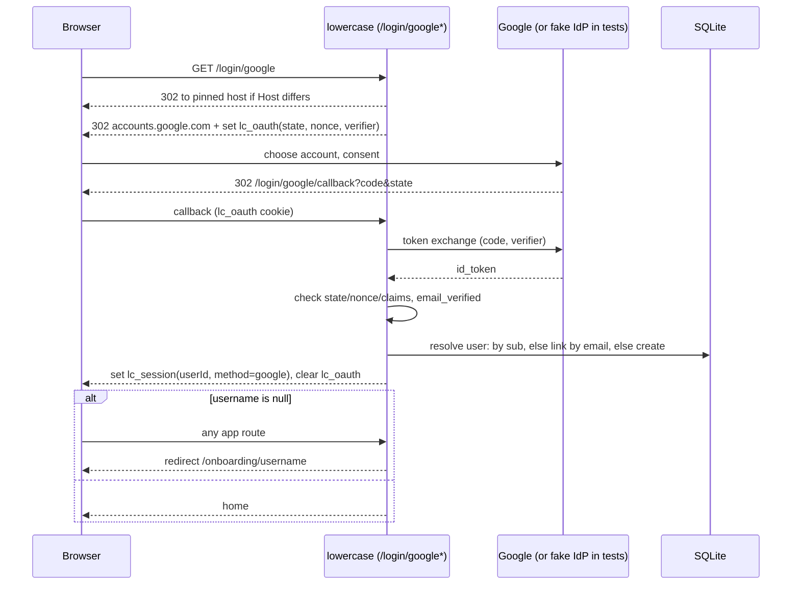
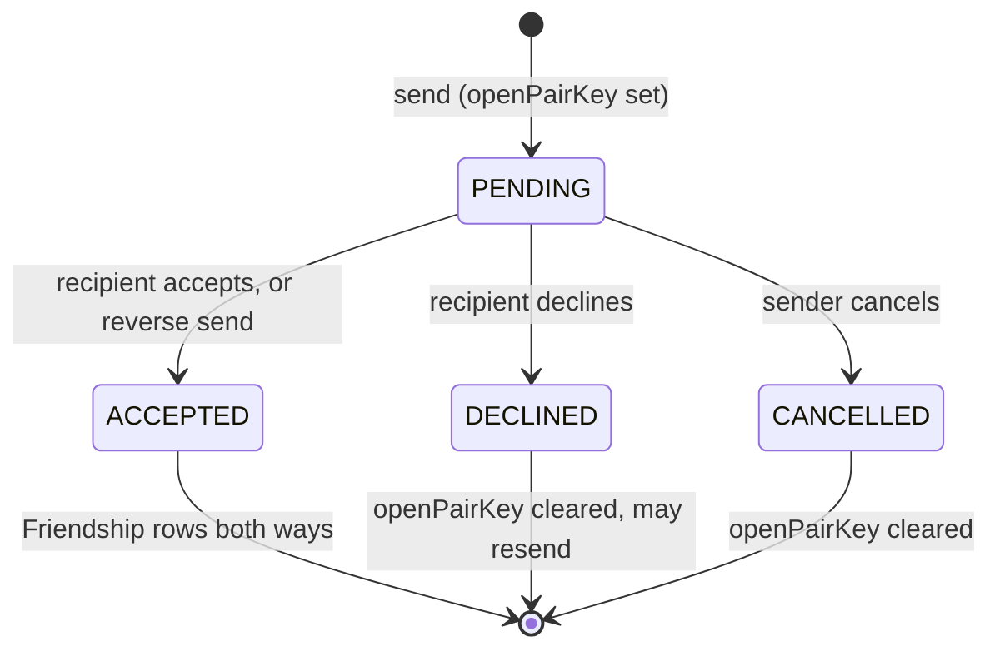
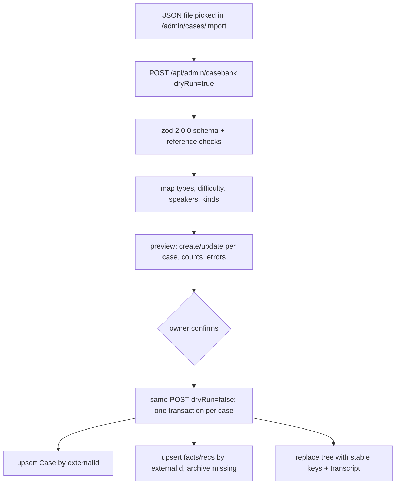

# Google Sign-In, Private Friends and Casebank Import - Plan

## Goal Capsule

- **Objective:** Friends practising at the owner's machine sign in to lowercase with their own Google account and choose a unique handle; reaching it from their own computers is left to a later hosting plan. They find each other only by that handle, through requests they accept, and nobody can browse who else has signed up. The owner stays the only person who can author content. The owner can load the 2.0.0 casebank into the CMS and run its cases live, with each fact's reveal guidance in front of the interviewer. The repo can be pushed to a private GitHub remote without exposing a secret.
- **Means:** Google OpenID Connect through `openid-client`, behind the existing auth seam, issuing the existing `lc_session` cookie (KTD1, KTD2). Request-based friendships on the existing Prisma/SQLite and Socket.IO stack (KTD8). A JSON importer that writes the casebank into an extended case model with stable tree keys (KTD11, KTD12).
- **Authority hierarchy:** Requirements (R-IDs) win on behaviour. Key Technical Decisions (KTD-IDs) win on mechanism within those requirements. Units carry unit-local detail and override neither.
- **Execution profile:** Brownfield work on branch `feat/lowercase-app` (no git remote). Run U1–U3 first because every later unit depends on the schema and the guards. After that, units follow the dependency column in the Unit Index. Auth, username and friend-request rules are unit-tested against the real SQLite test DB. Browser flows are proven with Playwright against a local fake Google IdP (KTD3), never real Google.
- **Stop conditions:** Stop and ask in any of these cases:
  - the migration cannot keep the owner's existing `prisma/dev.db` data;
  - `openid-client` cannot run inside the Next build or the custom server;
  - the owner wants the repo public, which changes U1 (see Risks, licensed content).
- **Who finishes:** The executor (`ce-work` or a human) completes all units and the Verification Contract. Three steps are the owner's: create the Google OAuth client and put its ID and secret in `.env`, then run the two owner-run Verification Contract checks (real Google sign-in, real casebank import), which need that client and the casebank JSON kept outside the repo. The executor reports any of these as pending when the owner hasn't done them. The run ends with the production server running locally.

---

## Product Contract

### Summary

Replace the test-only login with "Continue with Google" for everyone. Keep the passwordless test login only in local dev mode, for two-tab peer testing, and never grant admin through it. New accounts must pick a unique username before they can use the app. Admin rights belong only to a Google session for `davidsathyandevice@gmail.com`. Friends & Groups becomes private and request-based. The Sound Effects setting becomes reliable everywhere. The case model and CMS grow to hold the 2.0.0 casebank, the owner imports its 4 cases from the admin CMS, and the interviewer cockpit shows each fact's reveal guidance.

### Problem Frame

lowercase works today only for whoever sits at the machine, and every account is a seeded test login, so even a friend sitting beside the owner can't practise as themselves. This plan gives real friends their own Google-backed accounts on the owner's machine, and lays the auth, identity and privacy groundwork a later hosting plan needs so they can join from their own computers. The current Friends tab also works against privacy: search matches any name fragment across every account, adding a friend is instant and one-sided, and creating a group enrols people without asking them. The owner now has a structured casebank produced from a casebook. Its facts carry guidance on when to reveal them and what not to leak. The current case model can't hold that guidance, and its tree nodes get new ids on every save, so references into the tree would break. The Sound Effects toggle also doesn't behave reliably: an open lesson keeps the value it loaded with. Finally, the owner wants the repo on GitHub without leaking secrets, and the content stays private.

### Actors

- A1. Owner: `davidsathyandevice@gmail.com`. Every learner capability plus the admin CMS and casebank import, but only when signed in with Google.
- A2. Learner: any other Google-signed-in user with a username.
- A3. Peer tester: a seeded friend (Roy, Mihaela, Ankit), or the owner, signed in through the dev test login on the second loopback host. Never admin.
- A4. Newcomer: a Google-signed-in user who hasn't chosen a username yet.

### Key Flows

- F1. First Google sign-in
  - **Trigger:** A4 clicks "Continue with Google" on `/login`.
  - **Steps:**
    1. Google account chooser.
    2. The callback verifies the response.
    3. The account is matched or created (R5).
    4. The session starts.
    5. With no username, the user lands on "Choose your username" (R7), picks an available name and saves.
    6. The user arrives home.
  - **Covered by:** R3, R5, R7, R8, R9
- F2. Making a friend
  - **Trigger:** A2 types an exact username in Search.
  - **Steps:**
    1. One result appears, or none.
    2. A2 clicks "Add friend". The request shows in A2's Sent and in the other user's Received, with a badge.
    3. The recipient accepts. Both users now list each other as friends and see each other's presence live.
    4. "Start Session" works between them.
  - **Covered by:** R17, R18, R19, R22
- F3. Importing the casebank
  - **Trigger:** A1 opens Admin → Cases → Import.
  - **Steps:**
    1. A1 picks the JSON file and sees a preview: per case, create or update, with counts and errors.
    2. A1 confirms. The cases appear in the case list, editable in the CMS and playable in sessions.
  - **Covered by:** R23, R24, R25

### Requirements

**GitHub readiness**

- R1. No secret appears in any tracked file or in git history: no API key, client secret, DB file or populated `.env`.
- R2. `.gitignore` excludes `.env`, `.env.local` and every `.env.*` except `.env.example`. `.env.example` holds placeholder values only, including the new Google keys.

**Google sign-in**

- R3. `/login` offers "Continue with Google" as the primary way in. Signing in captures the Google account's email, name and avatar.
- R4. When `AUTH_MODE=dev`, the existing passwordless test login stays available below the Google button, including the peer-tester option. It never grants admin.
- R5. Accounts are tied to the Google account itself, not to the email address. A first Google sign-in whose verified email matches an existing unlinked account links to it, so the owner keeps their history. Email is no longer editable in Settings.
- R6. If the Google client isn't configured, the login page explains what to add to `.env` instead of failing, and the dev test login keeps working.

**Username onboarding**

- R7. A signed-in user with no username can reach only the "Choose your username" step. Every page, server action, API route and the live-session socket refuses them until they finish.
- R8. Usernames are trimmed, have a leading `@` stripped, and are compared case-insensitively. They are 3–20 characters: an ASCII letter (a–z) first, then a–z letters, digits, `.` or `_`.
- R9. The step checks availability as the user types, 300 ms after they stop, via `GET /api/users/check-username?username=…`. It shows "Checking…", "✓ Username is available", "✗ Username is already taken", or the rule the input breaks. Save stays disabled until the current input is valid and available.
- R10. The database enforces uniqueness. If someone else takes the name between the check and the save, the user sees "✗ Username is already taken" and keeps their input.

**Admin access**

- R11. A session is admin only when it came from Google with a verified email of exactly `davidsathyandevice@gmail.com`, compared case-insensitively.
- R12. For anyone else, every admin link and control is hidden, and `/admin`, every page under it, and `/cms` redirect to home.
- R13. Every CMS and casebank mutation refuses non-admins and changes nothing. Route handlers respond `403 Forbidden`, and server actions reject with "Not authorized".

**Sound effects**

- R14. The Sound Effects toggle flips the moment it's clicked. If saving fails, it flips back and says so.
- R15. The setting persists to the account and to the browser. It is restored on load, and a change in one tab applies to the user's other open tabs.
- R16. Every sound in the app goes through one player that checks the setting at the moment of playing. A sound the browser refuses is skipped silently.

**Friends & Groups**

- R17. No list of all users appears anywhere in Friends & Groups. People are found only by typing their exact username into Search. An empty search shows a prompt and the user's own handle, never a list.
- R18. Friends & Groups has five sub-tabs: My Friends, Groups, Search, Sent and Received. Received shows a count of pending items, and the top-nav Friends tab shows the same count.
- R19. Adding a friend sends a request:
  - The recipient can accept or decline it, and the sender can cancel it.
  - If the recipient had already requested the sender, sending accepts that request instead.
  - Requests to yourself, or to someone already your friend, are refused.
  - Acting on a request that is no longer open says so.
- R20. The Groups tab's top row holds "Search groups by name…" next to "+ Create Group". The old inline group-name pills are gone.
  - Below that row, the user sees their own groups with weekly leaderboards.
  - A search shows matching groups by name, owner and member count, with no leaderboard until the user joins.
  - Any group found can be joined directly, and a member who isn't the owner can leave.
- R21. Creating a group sends invites to the friends chosen. The invites appear in the invitee's Received and the owner's Sent, and accepting one joins the group.
- R22. "Start Session" is offered only between accepted friends. A newly accepted friend's online status shows without a reload.

**Casebank**

- R23. The case model holds everything a 2.0.0 casebank case carries:
  - industry and source pages;
  - each fact's category, tree node and reveal gate (prerequisite nodes, trigger, anti-leak rule, missed-fact nudge);
  - each node's stable id, status and formula;
  - recommendations with their category and target node;
  - the casebook's summary facts and the takeaways.
- R24. The owner imports a casebank JSON from the admin CMS. A preview lists each case as a create or an update, or gives the errors that block it. Confirming applies it. Importing the same file again updates those cases in place and leaves no duplicates.
- R25. Imported cases stay editable in the CMS: facts with their gate fields, and tree nodes with status and formula. Editing keeps every reference between facts, recommendations and tree nodes intact.
- R26. In a live session, the interviewer sees each fact's reveal guidance next to its Reveal button. The guidance is advisory, so Reveal is always available. The interviewee never receives any guidance field, category or summary fact. The one exception is the missed-fact nudge text that the import copies into hints (KTD13), which reaches the interviewee only through "I'm Stuck".
- R27. Cases authored before this change keep working exactly as before.

### Acceptance Examples

- AE1. **Covers R10.** Given Ana and Ben both see "✓ Username is available" for `alex`, when Ana saves first and then Ben saves, Ben sees "✗ Username is already taken", their input stays, and only one account holds `alex`.
- AE2. **Covers R11, R4.** Given the owner signs in through the dev test login before their account is linked to Google, when they open `/admin`, they are redirected home and no Admin tab shows. Once linked, the dev login refuses their account. Given they sign in with Google as `davidsathyandevice@gmail.com`, the Admin tab shows and `/admin` opens.
- AE3. **Covers R19.** Given Roy has a pending request to Mihaela, when Mihaela searches `roy` and clicks "Add friend", they become friends and Roy's request leaves Roy's Sent.
- AE4. **Covers R19.** Given Ankit cancelled their request to David, when David clicks Accept on the still-visible item, David sees "This request is no longer open" and the list refreshes.
- AE5. **Covers R24.** Given the 4-case casebank was imported and Roy revealed fact `F_001_04` in a session, when the owner imports the same file again, the preview shows 4 updates and 0 creates. Afterwards Roy's reveal record still points at that fact.
- AE6. **Covers R26.** Given an interviewer and interviewee in a Delhi Metro session, the interviewer's fact `F_001_06` shows its trigger, its prerequisite node labels and its don't-leak warning. The interviewee's socket payload contains none of those fields.

### Success Criteria

- The owner can run the casebank's Delhi Metro case at their machine with a real friend who signed in with their own Google account in a private window. Neither of them used a seeded login.
- Nothing in the app lists a user the viewer has neither friended nor searched for by exact handle, with three exceptions (KTD10). The league shows names without handles. A group the viewer chose to join shows its members' names. Group search results show the owner's display name, without a handle.

### Scope Boundaries

- The app stays local: one machine on loopback, SQLite and a custom server. Hosting it so friends sign in from their own machines is not part of this plan.
- There is no AI interviewer. The casebank's `agent_execution_rules` are stored nowhere and drive nothing. Reveal gates are advisory guidance for a human interviewer.
- Gates are not enforced. The app doesn't track which tree nodes the candidate has reached, so it can't block a reveal. Building that would need new session state and interviewer actions that nobody asked for. Evidence that would change this: interviewers revealing facts too early in practice.
- No username changes after onboarding, and no reserved-handle list. A rename needs collision and notification handling, and impersonating "admin" carries no privilege because admin is email-based (R11). It's cheap to add later, since it's validation only.
- No unfriending, blocking, group deletion or group ownership transfer.
- No session revocation. The stateless 30-day cookie stays as recorded in `docs/reviews/2026-10-15-code-review-residuals.md`. Real hosting would change this.
- Groups have no privacy setting: any group is joinable by name, per R20. Evidence that would change this: wanting a private study group.

#### Deferred to Follow-Up Work

- Hosting: secure cookies, removing the dev login from deployed builds, a database other than SQLite.
- Extra sound cues, such as a fact-revealed ping or an invite chime. The new player (R16) makes each one a single call.
- A CLI importer for batch casebank loads, using the same service as U10.

### Key Decisions

- **The test login is kept but never grants admin.** It's the only way to test two-person sessions with seeded friends on one machine. Governs R4, R11.
- **Username search matches the exact handle only.** A partial match would rebuild the directory one letter at a time. Governs R17.
- **The repo stays private.** The Mumbai seed case and the casebank come from a casebook marked not for sharing, and they're already in history. The casebank JSON itself is never committed. Governs R1. (session-settled: user-directed — chosen over a public repo with rewritten history: the licensed content stays in history.)
- **The league keeps showing names, but no usernames.** The league is part of the original product, and without a handle nobody can be requested from it. Governs R17.
- **Imported cases' "I'm Stuck" hints come from the facts' missed-fact nudges.** The casebank has no hints, and an empty "I'm Stuck" would break the interviewee's main help (KTD13). Governs R23.

---

## Planning Contract

### Key Technical Decisions

- KTD1. **Google OIDC via `openid-client@6.8.8`, pinned exactly, behind a `GoogleOidc` seam in `src/lib/auth/google.ts`.**
  - **Why this library:** Arctic is deprecated and unmaintained as of 2026-07-29. Auth.js v5 is still beta and owns its own session cookie, which clashes with `lc_session` and the socket handshake. `openid-client` validates iss, aud, exp, nonce, state and PKCE.
  - **Configuration:** static Google metadata, so there's no discovery round-trip. `scope=openid email profile`, `prompt=select_account`, PKCE S256, and no `access_type`.
  - **Signatures:** the id_token isn't signature-checked, because it comes straight from the token endpoint over TLS (OIDC Core 3.1.3.7).
  - **Fallback:** a hand-rolled `fetch` plus `node:crypto` version can replace it behind the same seam.
- KTD2. **Routes live under `/login/google` and `/login/google/callback`.**
  - The middleware already exempts `/login*`. A callback at `/api/auth/*` would bounce to `/login`, because a new user has no cookie yet.
  - `GOOGLE_REDIRECT_URI` pins one canonical URI (default `http://localhost:3000/login/google/callback`).
  - The start route redirects a `127.0.0.1` visitor to the pinned host, because cookies are per host.
  - The callback builds its URL from the pinned URI plus the query, never from the Host header.
  - State, nonce and verifier travel in one httpOnly, SameSite=Lax cookie scoped to `/login/google`, signed with the existing `sign()` HMAC. It lasts 10 minutes and is cleared on every outcome. Signing stops a page on another localhost port from planting a forged cookie, because SameSite ignores ports.
  - Failures redirect to `/login?error=<code>`, where the code is one of `google_cancelled | google_expired | google_failed | google_unverified | google_conflict | google_unconfigured`. The login page maps each code to fixed text, so query strings can't inject arbitrary messages. The `/login/as` route switches to the same codes.
- KTD3. **One fake Google IdP serves both test suites:** `tests/helpers/fake-google.ts`, plain `node:http` on port 0.
  - The app honours `GOOGLE_OIDC_BASE_URL` only when `LC_FAKE_GOOGLE=1` and the URL's host is loopback, and only then calls `allowInsecureRequests`. Only `scripts/e2e-server.ts` and the Vitest env set `LC_FAKE_GOOGLE`. `AUTH_MODE=dev` alone isn't enough, because `ensure-db` turns it on in every install, and the unsigned id_token would let any endpoint at that URL claim the owner's email.
  - The fake checks PKCE and echoes the nonce. It emits `alg: RS256` (openid-client rejects any other header alg), and its claims are set per test.
  - `scripts/e2e-server.ts` starts it in process and sets the Google env vars.
- KTD4. **Identity is keyed on `User.googleSub`, which is unique.**
  - Look up by `sub` first. Then look up by the verified, lowercased email, but only for rows with no `googleSub` and not `isLeagueBot`. Link with a conditional update.
  - If the email belongs to a row that already has a different `googleSub`, refuse with `google_conflict`.
  - Refuse any `email_verified !== true`, because openid-client doesn't check it.
  - On each sign-in, refresh `email` from the claims when the `sub` matches. Refresh `avatarUrl` too, storing it only when it's an `https:` URL on `*.googleusercontent.com`, and null otherwise.
  - Names map as `given_name ?? first word of name`, and `family_name ?? the rest ?? ""`.
  - Two simultaneous first callbacks resolve by catching P2002 and reading again.
  - Email is lowercased on every write path.
- KTD5. **The session cookie records how the user signed in, and admin is computed rather than stored.**
  - `createSessionValue(userId, method)` with method `google | dev`. Cookies in the old format fail verification, so the user signs in again.
  - The `User.isAdmin` column is dropped. `SessionUser.isAdmin` is `method === "google" && lowercased email === ADMIN_EMAIL`. That's sound because email is written only from verified Google claims or the seed (KTD4), and Settings can no longer edit it (R5).
  - `ADMIN_EMAIL` is a code constant, not an env var: the rule names one fixed address, and env can't widen it.
  - Every reader of `isAdmin` goes through this one computation: TopNav, AccountMenu, TestingControls, `setGateModeAction`, unpublished concept preview in `learn.ts`, guards and the socket.
  - The dev login admits only seeded accounts that have never signed in with Google: the owner and `roy`, `mihaela` and `ankit`, each only while its `googleSub` is null. Otherwise anyone at the machine could sign in as a real friend by typing their handle.
  - Settings stops accepting `email` in the same unit that introduces computed admin (U3), not later. SQLite's `@unique` is case-sensitive, so until then a user could save `DavidSathyanDevice@gmail.com` and pass the lowercased admin check.
- KTD6. **The guards are the onboarding gate.**
  - `getCurrentUser()` returns `{ user, method }`.
  - `requireSignedIn()` admits a user with no username. Only the onboarding page and the check and save endpoints use it.
  - `requireUser()` redirects a user with no username to `/onboarding/username`. Pages and server actions already call it. `/api/export` calls `getCurrentUser` today and switches to `requireUser`, so R7 holds below the layout.
  - The onboarding page doesn't render inside `AppShell`. `AppShell` calls `requireUser`, which would loop the page back to itself.
  - The Socket.IO `io.use` handshake rejects users with no username.
  - `requireAdmin()` redirects home instead of returning a 404. `assertAdmin()` throws `new ServiceError("Not authorized")`. Each admin `run()` wrapper, and `setGateModeAction`'s settings `run()`, calls it inside the wrapper's own try. The wrappers' existing `ServiceError` mapping then returns `{ ok: false, error: "Not authorized" }` without touching the DB. A plain `Error` would surface as "Something went wrong". New admin route handlers use an `adminRoute()` helper. It authorizes before reading the body and responds 403 to non-admins. For non-GET requests it also requires `Content-Type: application/json` and an `Origin` equal to the pinned origin, because route handlers get none of the Origin checks Next gives server actions.
- KTD7. **`username` becomes `String? @unique` and is always stored in canonical lowercase.**
  - SQLite treats NULLs as distinct under UNIQUE, so the plain index gives case-insensitive uniqueness once every write path normalises through one `normalizeUsername()` with the R8 regex.
  - This is chosen over a separate `usernameKey` column, because the app already lowercases usernames and so do all the seeds. It's also chosen over a raw `lower()` expression index, because Prisma silently drops that on any later table rebuild.
  - It's chosen over generating a handle at sign-in too, because R7 requires the explicit choice.
  - Code that reads people (`personSelect` consumers) filters `username: { not: null }` and narrows through a `toPerson()` mapper, so downstream types stay `string`.
- KTD8. **Friend requests are a `FriendRequest` model whose `openPairKey String? @unique` is set only while the request is pending.**
  - The key is the two user ids, sorted and joined.
  - This gives "one open request per pair" in Prisma 6 on SQLite, which has no partial unique indexes. Two simultaneous opposite requests collide on the key, and the loser takes the accept-reverse path.
  - **The invariant:** the key is non-null exactly when the status is PENDING.
  - **Terminal transitions:** every one (accept, decline, cancel, a direct join for invites) is a single conditional `updateMany`. It's the first statement in its transaction, as in `acceptInvite`, and it sets the status and clears the key together.
  - **Acting user:** the update is scoped to that user: `toId: me` to respond, `fromId: me` to cancel. A zero count means "no longer open". So a sender can't accept their own request, and a third party can't touch it.
  - **Accepting:** that same transaction then upserts both directional `Friendship` rows, because `areFriends` is directional.
  - **Sending:** you send by username, never by id. The username resolves with search's filters: no bots, no null usernames, not yourself. League standings expose user ids, so taking an id would bypass "exact handle only".
  - **Declining** is silent: the item leaves both lists and the sender can send again later.
  - **Relations:** every relation on `FriendRequest` and `GroupInvite` uses `onDelete: Cascade`, like the rest of the schema, so deleting a user removes their open keys with their rows.
  - **Group invites:** `GroupInvite` follows the same shape, with `openKey` set to `groupId:toId`. Joining directly resolves a pending invite for that group and user through the same conditional update. A member who leaves can be invited again.
- KTD9. **Server actions reach Socket.IO through a `globalThis` handle, `src/server/realtime/io-handle.ts`.** That's the same pattern presence already uses for sharing between the tsx and Next module copies.
  - Request and invite changes emit `social:changed` to each affected user's room, carrying that user's own Received count. Emits happen only after the transaction commits, and only when its conditional update changed exactly one row.
  - Accepting a request, and only accepting, also pushes `presence:update` for each new friend to the other, so "Start Session" enables without a reload (R22). A pending request reveals no presence.
  - The client's `RealtimeBridge` refreshes the router and the badge store.
- KTD10. **League rows carry a display name and XP, but no username.** League and group queries exclude users with no username. Group standings show the username only to friends. Group search results show the owner's display name, not their handle, so searching two-letter substrings can't collect handles.
- KTD11. **Tree nodes get a stable `key` column, unique per case.**
  - The migration backfills existing nodes with `key = id`.
  - `writeTree` persists `node.key`. `TreeBuilder` keeps keys across saves and generates one only for a new node.
  - Facts and recommendations reference nodes by key (`nodeKey`, which a recommendation uses for its target, and prerequisite keys as a JSON string array). Their ids survive the tree's delete-and-recreate save.
  - `validateTree` rejects duplicate or empty keys, because its Map would otherwise collapse them before the unique index raises a raw P2002. A CMS tree save that would drop a key a live fact or recommendation still references is refused, with a message naming them, so editing never breaks a reference (R25). The owner re-points or archives those items first.
  - `writeTree` throws on any node it can't place. The importer calls it directly, without going through `saveTree`.
  - Node `status` (`ACTIVE_BRANCH | ELIMINATED_BRANCH | ROOT_CAUSE`, default ACTIVE_BRANCH) and an optional `formula` join `isCorrectPath`, which stays the source of blue versus grey. ROOT_CAUSE adds a solid amber border, an amber tint and a target icon labelled "Root cause". The amber ring stays reserved for the selected node, which `IssueTree` already draws that way.
- KTD12. **Casebank import is one service, `importCasebank(db, doc, { dryRun })`,** validated by a zod schema for 2.0.0 in `src/lib/casebank.ts`.
  - **Mapping:**
    - Difficulty: Easy, Moderate and Difficult map to levels 1, 2 and 3.
    - `case_type`: matching names pass through, and `Growth` becomes `Revenue Growth`. `Unconventional` is a validation error, since the app has no such type.
    - Speakers are lowercased. `summary_takeaways` become `observation` items.
    - `case_facts_given` become a new interviewer-only kind, `given`.
  - **Item identity:** every imported item has a deterministic, non-null `externalId`. Facts use `fact_id`, recommendations `rec_id`, hints `hint:<nodeKey>` (KTD13), and given facts and takeaways `given:<n>` and `takeaway:<n>`. The unique key is `(caseId, kind, externalId)`.
  - **Upserts:**
    - Cases upsert on `Case.externalId` (`case_id`). Items upsert in place.
    - The update sets text, `order`, every rich field and `archivedAt: null`, so a fact that was removed and then restored reappears.
    - Items missing from the file are archived, never deleted, so `SessionReveal` and `SessionHintUse` history survives (AE5). That includes items the owner added in the CMS to an imported kind.
    - An id that moves between kinds archives the old row and creates a new one.
    - The preview warns that a re-import overwrites CMS edits to imported items.
  - **Tree and transcript:** both are replaced. The transcript is inserted in bulk. No session history references either.
  - **Validation before any write:**
    - Duplicate case, fact, recommendation or node ids are rejected.
    - Every cross-reference is checked with `Map` and `Set`, never plain objects, so `constructor` can't pass as a node id.
    - Ids must match `^[A-Za-z0-9_:-]{1,64}$`, and text fields have max lengths.
    - A dry run returns the same preview and writes nothing.
  - **Transactions:**
    - Each case is one interactive transaction with an explicit `timeout` and `maxWait`, as the seed sets.
    - The response reports each case as applied or failed. Cases already applied stay committed, and a re-run converges.
    - Updating a case that has an ACTIVE session is refused, as `deleteCase` already does.
  - **Endpoint and publishing:** the endpoint is the route handler `POST /api/admin/casebank` (KTD6, 403 for non-admins). It caps the streamed body at 2 MB, checking `Content-Length` first. Imported cases are published.
- KTD13. **Hints for imported cases are derived from the missed-fact nudges.** For each node on `correct_issue_path`, in order, the first mapped fact's nudge becomes a hint keyed `hint:<nodeKey>`, with duplicate text dropped. The owner can edit them in the CMS, though a re-import overwrites those edits (KTD12). The cockpit's hints-remaining count includes only uses of active hints, so an archived hint can't double-count. The alternative, importing no hints, leaves "I'm Stuck" empty on all 4 cases.
- KTD14. **Sound goes through one controller, `src/lib/sound.ts`, plus a Zustand store.**
  - **Source of truth:** the DB value, delivered by `AppShell`, is authoritative on load.
  - **Browser copy:** it's mirrored to `localStorage` under a per-user key (`lc:sound:<userId>`). The `storage` event carries a change to the user's other tabs.
  - **Playing:** `play(name)` reads the store at the moment of playing, resumes a suspended `AudioContext`, and swallows any rejection.
  - **Lessons:** `LessonRunner` stops reading the `lesson.soundOn` snapshot.
  - **Toggle:** it updates optimistically and reverts with a toast if the save fails.
  - The reported bug wasn't reproduced from the code alone. The likely cause is the stale lesson snapshot, and U6 starts by reproducing it.
- KTD15. **The migration is authored offline, and `ensure-db` backs up before it migrates.**
  - **Why:** Prisma doesn't wrap SQLite migrations in a transaction. Its generated `IssueTreeNode` rebuild copies rows without `key`, so it passes on empty test DBs and fails on real data. A replay of the owner's DB showed what happens: `User` rebuilt, `Case` altered, a stray `new_IssueTreeNode` left behind, and every later `migrate deploy` stopping with P3009, so the app can't boot.
  - **Authoring:** the SQL comes from `prisma migrate diff`, comparing the committed migrations with the new schema against a scratch shadow DB. No authoring command ever points at `dev.db`, and `migrate dev --create-only` also refuses non-interactive shells. The SQL is then hand-edited to copy `key` from `id`.
  - **Transactions:** the migration is never wrapped in a transaction. Prisma's `PRAGMA foreign_keys=OFF` around the `User` rebuild works only outside one. Inside one, `DROP TABLE "User"` would cascade-delete rows from 9 child tables.
  - **Backup:** when migrations are pending and the DB has users, `ensure-db` first writes a timestamped `VACUUM INTO` backup, which captures the WAL; a file copy wouldn't. If `migrate deploy` fails, it prints the restore steps (Risks).
  - **Freezing:** the migration is frozen once anything has applied it to `dev.db`. `migrate deploy` never re-applies an edited migration, so later changes go in a new one.
- KTD16. **lowercase answers only on its own loopback names.**
  - **Why:** binding to `127.0.0.1` doesn't stop DNS rebinding. A page on `evil.example` that resolves to 127.0.0.1 gets same-origin requests with `Host: evil.example`, and Next's server-action Origin check passes, because Origin and Host then match. With the dev login on by default, that page could sign in and read `/api/export`.
  - **Host check:** `server.ts` rejects HTTP and upgrade requests whose Host isn't `localhost:PORT` or `127.0.0.1:PORT`, responding 421 Misdirected Request.
  - **Socket check:** Socket.IO gets an `allowRequest` Origin allowlist with the same two origins. This closes the open item in `docs/reviews/2026-10-15-code-review-residuals.md`.
  - **Peer login:** `/login/as/[username]` becomes a page with a button that posts through a server action, which gets Next's Origin check. The action redirects to a fixed origin built from the allowlisted Host. Today it's a GET that any cross-site link can trigger, replacing the owner's Google session.

### High-Level Technical Design

Google sign-in and the onboarding gate:

Friend request states (group invites follow the same states):

Casebank import data flow:

### Sequencing

U1 is independent. U2 (schema) and U3 (session and guards) unblock everything else. After U3:

- the auth branch: U4, then U5;
- U6, on its own;
- the friends branch: U7, then U8;
- the casebank branch: U9, then U10 and U11.

U12 runs last.

### Assumptions

- The rest of the Groups spec was cut off in the request. R20 and R21 fill it as described: public join by name, Leave, invites from Create Group.
- Google accepts `http://127.0.0.1:3000/...` as a redirect URI for a Web client. It's documented but unverified. If it doesn't, Google sign-in is offered only on `localhost`, which the redirect in KTD2 already handles.

---

## Implementation Units

| U-ID | Title | Key files | Depends on |
|---|---|---|---|
| U1 | GitHub readiness | `.gitignore`, `.env.example`, `scripts/ensure-db.ts`, `README.md` | none |
| U2 | Schema migration and seed | `prisma/schema.prisma`, `prisma/migrations/*`, `scripts/ensure-db.ts`, `src/server/seed-runner.ts`, `src/lib/types.ts` | none |
| U3 | Session method, computed admin, guards, loopback hardening | `src/lib/auth/*`, `server.ts`, `src/server/realtime/index.ts`, `src/app/(app)/admin/**`, `src/app/cms/page.tsx`, `src/app/login/as/**` | U2 |
| U4 | Google sign-in | `src/lib/auth/google.ts`, `src/app/login/google/**`, `src/app/login/page.tsx`, `tests/helpers/fake-google.ts` | U3 |
| U5 | Username onboarding | `src/app/onboarding/username/*`, `src/app/api/users/check-username/route.ts`, `src/lib/username.ts` | U3 |
| U6 | Sound effects controller | `src/lib/sound.ts`, `src/stores/sound.ts`, `src/components/settings/SettingsForms.tsx`, `src/components/learn/LessonRunner.tsx` | U3 |
| U7 | Friend requests and group invites backend | `src/server/services/social.ts`, `src/server/realtime/io-handle.ts`, `src/app/(app)/friends/actions.ts` | U2, U3 |
| U8 | Friends & Groups UI | `src/components/friends/*`, `src/app/(app)/friends/page.tsx`, `src/components/shell/TopNav.tsx` | U7 |
| U9 | Stable tree keys and extended case editing | `src/components/admin/TreeBuilder.tsx`, `src/components/admin/CaseEditor.tsx`, `src/server/services/admin-cases.ts`, `src/lib/rules/tree.ts` | U2, U3 |
| U10 | Casebank importer | `src/lib/casebank.ts`, `src/server/services/casebank.ts`, `src/app/api/admin/casebank/route.ts`, `src/app/(app)/admin/cases/import/page.tsx` | U9 |
| U11 | Interviewer reveal guidance | `src/components/session/interviewer/InterviewerView.tsx`, `src/server/services/sessions.ts`, `src/components/issue-tree/*` | U9 |
| U12 | E2E, docs and final pass | `tests/e2e/*`, `scripts/e2e-server.ts`, `README.md` | U4–U11 |

### U1. GitHub readiness

- **Goal:** The repo can be pushed to a private remote with no secret in the tree or history.
- **Requirements:** R1, R2; Key Decision "The repo stays private".
- **Dependencies:** none.
- **Files:** `.gitignore`, `.env.example`, `scripts/ensure-db.ts`, `README.md`.
- **Approach:**
  1. Scan tracked files and the full history for secret patterns: Google `AIza` and `GOCSPX`, `sk-`, `client_secret`, `AUTH_SECRET=` with a non-placeholder value, and `.db` or `.env` blobs. Record the result in the commit message.
  2. `.gitignore`: add `.env*` with `!.env.example`, `.env.local`, `content/private/`, `prisma/backups/`, `UI/` and `*.docx`. The existing `prisma/*.db` rule doesn't reach files in `prisma/backups/`, and those backups hold the licensed casebank content. The untracked `UI/` folder and the `Fake News Strategy.docx` at the repo root are one `git add .` away from being committed.
  3. `.env.example`: add placeholders for `GOOGLE_CLIENT_ID`, `GOOGLE_CLIENT_SECRET` and `GOOGLE_REDIRECT_URI`. Keep `AUTH_MODE=dev` with its warning comment.
  4. `ensure-db.ts` keeps generating `AUTH_SECRET`. It never writes Google keys.
  5. README: a section on setting up the Google client (Google Auth Platform, Web application client, both redirect URIs, the secret is shown only once, idle clients are deleted after 6 months), and a note that the repo must stay private because of the licensed casebook content.
- **Test expectation:** none. This is config and docs. Verification is the scan result plus `git check-ignore` on `.env.local`, `.env.production` and `content/private/x.json`, with `.env.example` still tracked.
- **Verification:** The history scan finds nothing. `git check-ignore` matches `.env.local`, `.env.production`, `content/private/x.json` and `prisma/backups/dev-x.db`, and `.env.example` is still tracked.

### U2. Schema migration and seed

- **Goal:** One migration adds every new column and model and keeps existing data.
- **Requirements:** R5, R7, R10, R19, R21, R23, R27; KTD4, KTD5, KTD7, KTD8, KTD11, KTD12, KTD15.
- **Dependencies:** none.
- **Files:** `prisma/schema.prisma`, a new migration under `prisma/migrations/`, `scripts/ensure-db.ts` (pre-migration backup), `.gitignore` (`prisma/backups/`), `src/server/seed-runner.ts`, `prisma/seed/users.ts`, `src/lib/types.ts`, `src/lib/username.ts` (new: `normalizeUsername()` with the R8 rule, shared by U5 and U7 per KTD7), `tests/unit/migration.test.ts`, `tests/unit/username.test.ts` (normalisation cases), `tests/unit/seed.test.ts` (drops the `isAdmin` assertion).
- **Approach:**
  - **`User`:**
    - `username` becomes nullable and unique.
    - Add `googleSub String? @unique` and `avatarUrl String?`.
    - Drop `isAdmin`.
  - **New models:**
    - `FriendRequest`: `id, fromId, toId, status, openPairKey String? @unique, createdAt, respondedAt?`.
    - `GroupInvite`: `id, groupId, fromId, toId, status, openKey String? @unique, createdAt, respondedAt?`.
    - Every relation on both uses `onDelete: Cascade` (KTD8).
  - **`Case`:** add `externalId String? @unique`, `industry String?` and `sourcePages String?` (a JSON array).
  - **`CaseItem`:**
    - Add `externalId String?`, `category String?`, `nodeKey String?` and `sourceTurn Int?`.
    - Add the gate fields `gatePrereqKeys String?` (a JSON array), `gateTrigger String?`, `gateAntiLeak String?` and `gateNudge String?`.
    - Add `@@unique([caseId, kind, externalId])` (KTD12).
    - The recommendation target reuses `nodeKey`.
  - **`IssueTreeNode`:**
    - Add `key String`, backfilled to the row id, with `@@unique([caseId, key])`.
    - Add `status String @default("ACTIVE_BRANCH")` and `formula String?`.
  - **Types:** `src/lib/types.ts` adds the `given` kind, the node status and fact category unions, and the request and invite statuses.
  - **Seed:** drop `isAdmin`. Owner, peers and bots keep their lowercase usernames.
  - **Authoring the migration:** follow KTD15.
    - Generate the SQL with `migrate diff` against a scratch shadow DB.
    - Hand-edit it so the `IssueTreeNode` copy step fills `key` from `id`.
    - Check that the SQL rebuilds only `User` and `IssueTreeNode`. If `Case` or `CaseItem` were rebuilt, `SET NULL` foreign keys would blank `CaseSession.caseId` and `CaseResult.caseId` while keeping row counts the same.
  - **Backup:** `ensure-db` takes a `VACUUM INTO prisma/backups/dev-<timestamp>.db` backup before `migrate deploy` whenever migrations are pending and users exist. Add `prisma/backups/` to `.gitignore`.
- **Execution note:**
  - Prove the migration on a copy of `prisma/dev.db` before anything runs `ensure-db` against the real file. `npm run dev` and `npm run start` both migrate whatever `DATABASE_URL` points at, and U12 is the first step that runs them against the real file.
  - Until U12, run the app against a copy (`DATABASE_URL`).
  - Once the migration has touched `dev.db`, it's frozen (KTD15).
- **Patterns to follow:** the existing `prisma/migrations/20261015084915_init`. Status strings are typed by unions (the KTD3 comment at the top of the schema).
- **Test scenarios:**
  - **Migration replay:** build a DB from the init migration only and insert rows into every child table of `User`, a 3-level issue tree, a `SessionReveal` and a `SessionHintUse`. Then deploy the real migrations folder and check:
    - every table's row count matches;
    - each node's `key` equals its old id;
    - `PRAGMA foreign_key_check` is empty;
    - every `_prisma_migrations` row is finished;
    - no `new_*` table remains;
    - non-null `CaseSession.caseId` and `CaseResult.caseId` counts are unchanged.
  - With migrations pending and users present, `ensure-db` writes a backup file before deploying. With no users, it writes none.
  - Two users with a NULL username can coexist.
  - Two `FriendRequest` rows with the same non-null `openPairKey` violate uniqueness. Two with NULL don't.
  - `seedDatabase` on an empty DB produces the same users, friendships, cases and concepts as before, minus `isAdmin`.
- **Verification:**
  - `prisma migrate deploy` applies cleanly to a fresh DB and to the copied `dev.db`.
  - Before and after the migration, the copy has 0 mixed-case usernames, 0 mixed-case emails and 0 usernames breaking R8. Stop if any count isn't 0.
  - The existing unit suite still passes after the type fixes.

### U3. Session method, computed admin, guards

- **Goal:** Admin follows R11 everywhere, and the guards enforce onboarding below the layout.
- **Requirements:** R4, R5, R7, R11, R12, R13; KTD5, KTD6, KTD10, KTD16.
- **Dependencies:** U2.
- **Files:**
  - **Auth:** `src/lib/auth/session-cookie.ts`, `src/lib/auth/provider.ts`, `src/lib/auth/guards.ts`, `src/lib/auth/dev-provider.ts`, `src/lib/auth/constants.ts`.
  - **Routes and pages:** `src/app/login/as/[username]/route.ts` (becomes `page.tsx` plus an action), `src/lib/peer-url.ts`, `src/lib/auth/actions.ts`, `src/app/(app)/admin/**/page.tsx`, `src/app/cms/page.tsx` (new), `src/app/api/export/route.ts`.
  - **Admin actions:** `src/app/(app)/admin/cases/actions.ts`, `src/app/(app)/admin/concepts/actions.ts`, `src/app/(app)/settings/actions.ts`.
  - **Server:** `server.ts` (Host allowlist), `src/server/services/learn.ts`, `src/server/services/home.ts`, `src/server/services/settings.ts` (email no longer accepted), `src/server/realtime/index.ts`.
  - **Shell UI:** `src/components/shell/TopNav.tsx`, `src/components/shell/AccountMenu.tsx`, `src/app/(app)/settings/page.tsx` (renders TestingControls from the computed admin flag), `src/components/settings/SettingsForms.tsx` (email shown read-only).
  - **Tests:** `tests/unit/auth.test.ts`, `tests/unit/admin-actions.test.ts`, `tests/unit/settings.test.ts`, `tests/unit/realtime.test.ts`, `tests/unit/guards.test.ts` (new), `tests/unit/host-allowlist.test.ts` (new).
- **Approach:**
  1. **Cookie:** the payload gains the method (KTD5), and old values fail verification.
  2. **Session shape:** `SessionUser` gains `avatarUrl` and a computed `isAdmin`. `toSessionUser(user, method)` is the single place admin is decided.
  3. **Guards:** `requireSignedIn`, `requireUser`, `requireAdmin` (now redirect-home), `assertAdmin` and `adminRoute()`, per KTD6. `/api/export` moves to `requireUser`.
  4. **`/cms`:** a page that redirects admins to `/admin` and everyone else home.
  5. **Admin `run()` wrappers:** `assertAdmin()` throws a `ServiceError`, and it moves inside the try of each admin `run()` and inside `setGateModeAction`'s `run()` callback (KTD6).
  6. **Socket handshake:** reject a session with no username (`onboarding_required`), and attach the method to `socket.data`.
  7. **League:** drop usernames from `getLeague` and exclude null usernames (KTD10).
  8. **Dev login:** admits only the seeded accounts that KTD5 lists, and every session it creates has method `dev`. The owner's button now reads "Continue as davidsathyandevice (test login, no admin)".
  9. **Settings:** `accountInput` and `updateAccount` drop `email`. The form shows it read-only, labelled "From your Google account" (KTD5, R5).
  10. **Loopback hardening (KTD16):**
      - the Host allowlist in `server.ts`, for HTTP and upgrade requests;
      - the Socket.IO `allowRequest` Origin allowlist;
      - `/login/as/[username]` as a page with a POST action.
      `peer-url.ts` keeps pointing at that page.
- **Patterns to follow:** the current `guards.ts`, with `cache()` per request; the `requireAdmin` call at the top of each admin page.
- **Test scenarios:**
  - Covers AE2. A dev-method cookie for the owner yields `isAdmin === false`. A google-method cookie for the owner yields `true`. A google-method cookie for Roy yields `false`.
  - **Cookie validation:**
    - A cookie in the old format (userId.issued.sig) fails verification.
    - Editing the method from `dev` to `google` breaks the signature.
    - A missing or unknown method is rejected.
  - **Dev login:** it refuses an account that has a `googleSub`, and one created through Google. It also refuses the owner once their row is linked to Google.
  - **Settings:** a Google user who submits `DavidSathyanDevice@gmail.com` in the account form keeps their own email and stays non-admin.
  - **Onboarding gate:**
    - `requireUser` for a user with a null username redirects to `/onboarding/username`. `requireSignedIn` returns that user.
    - `/api/export` for a user with a null username is refused.
    - The socket handshake with a null-username user is refused.
  - **Admin actions:** every admin concept and case action, plus `setGateModeAction`, called with a dev-method owner cookie returns "Not authorized" and changes no row. This extends `tests/unit/admin-actions.test.ts`.
  - **`adminRoute`:**
    - responds 403 to a non-admin;
    - responds 403 to an admin POST whose `Origin` is `http://localhost:4000` or that has `Content-Type: text/plain`;
    - calls the handler for an admin JSON POST from the pinned origin.
  - **Host and Origin allowlists:**
    - A request with `Host: evil.example` gets 421. `localhost:PORT` and `127.0.0.1:PORT` are served.
    - A socket from Origin `http://evil.example` is refused.
  - **Peer login:** a cross-site GET to `/login/as/roy` sets no cookie. Only the page's POST action signs in.
  - **League:** payload entries have no `username` field and omit users with no username.
- **Verification:** Unit tests pass. As a dev-login owner, `/admin` and `/cms` redirect home and no Admin tab shows.

### U4. Google sign-in

- **Goal:** "Continue with Google" signs users in, links the seeded owner, and fails with clear messages.
- **Requirements:** R3, R5, R6; KTD1, KTD2, KTD3, KTD4.
- **Dependencies:** U3.
- **Files:**
  - **Auth:** `package.json` (`openid-client` 6.8.8, exact), `src/lib/auth/google.ts`, `src/server/services/google-account.ts`.
  - **Routes and pages:** `src/app/login/google/route.ts`, `src/app/login/google/callback/route.ts`, `src/app/login/page.tsx`, `src/components/login/*`.
  - **Settings and avatars:** `src/server/services/settings.ts` (`accountInput` lets `lastName` be empty), `src/components/home/Avatar.tsx` (renders `avatarUrl` with `referrerPolicy="no-referrer"`, falling back to the initials tile if the image fails to load). `avatarUrl` reaches the account menu, the Friends lists, the session lobby and partner status. League and group standings keep initials (KTD10).
  - **Config:** `vitest.config.ts` (env), `next.config.ts` (`openid-client` in `serverExternalPackages` if the build needs it).
  - **Tests:** `tests/helpers/fake-google.ts`, `tests/unit/google-account.test.ts`, `tests/unit/google-routes.test.ts`.
- **Approach:**
  - **Routes:** both routes take a `NextRequest` and set cookies on the `NextResponse`, like `/login/as`, so no `next/headers` mock is needed.
  - **User resolution:** `resolveGoogleUser(db, claims)` holds the linking rules (KTD4) and returns the user or a refusal code.
  - **Claims:** a zod schema parses them.
  - **Unconfigured client:** with the Google env vars unset, the start route redirects to `/login?error=google_unconfigured`, and the page shows the setup hint (R6) with the button disabled.
  - **Login page:** the Google button comes first. The dev section renders only when `AUTH_MODE=dev`, and is labelled "Testing". It lists only the accounts the dev login would admit right now (KTD5), so the owner's prefilled button disappears once their account is linked, and the section hides when nothing is left.
- **Patterns to follow:** `NextResponse` cookie handling as in today's `src/app/login/as/[username]/route.ts`; `src/lib/auth/session-cookie.ts` for options and `sign()`.
- **Test scenarios:**
  - **New user:** a new `sub` with a new verified email creates a user with a null username, `googleSub` set, the avatar stored and the email lowercased.
  - **Avatar:** a `picture` on `https://lh3.googleusercontent.com/...` is stored. An `http:` URL, or one on another host, stores null.
  - **Linking:**
    - A verified `DavidSathyanDevice@gmail.com` with no `googleSub` on the owner row links to the seeded owner. `username` stays `davidsathyandevice`.
    - The same `sub` with a changed email updates the email on the matched row.
  - **Refusals:**
    - An email whose row has a different `googleSub` returns `google_conflict` and changes nothing.
    - `email_verified: false` returns `google_unverified`, and no row is created.
    - A league-bot email is never linked.
  - **Race:** two concurrent resolves for the same new `sub` produce one user.
  - **Name mapping:** with no `family_name`, `lastName` is `""` and Settings can still save the account.
  - **Callback routes:**
    - With the fake IdP, the callback sets `lc_session` (HttpOnly, SameSite=Lax), clears `lc_oauth` and redirects to `/`.
    - A missing `lc_oauth` cookie, or one with a bad signature, redirects to `google_expired`.
    - A state mismatch redirects to `google_failed`, and so does a nonce mismatch, which needs `expectedNonce` passed.
    - `?error=access_denied` redirects to `google_cancelled`.
    - An unknown `?error=` code on `/login` shows the generic message, never the raw value.
    - The fake receives the right `code_verifier` for the challenge.
  - **Start route:**
    - A request on Host `127.0.0.1:3100` redirects to the pinned `localhost` host.
    - With the env vars unset, it redirects to `google_unconfigured`.
    - With `GOOGLE_OIDC_BASE_URL` set but `LC_FAKE_GOOGLE` unset, or set to a non-loopback URL, the real Google metadata is used (KTD3).
- **Verification:** Unit tests pass against the fake IdP. The owner signs in through a real Google client once (manual, see the Verification Contract).

### U5. Username onboarding

- **Goal:** Newcomers choose a valid, unique username before using the app.
- **Requirements:** R7, R8, R9, R10; KTD6, KTD7.
- **Dependencies:** U3.
- **Files:** `src/app/onboarding/username/page.tsx`, `src/app/onboarding/username/actions.ts`, `src/components/onboarding/UsernameForm.tsx`, `src/app/api/users/check-username/route.ts`, `src/server/services/username.ts`, `tests/unit/username.test.ts`, `tests/unit/check-username-route.test.ts`.
- **Approach:**
  - **Normalisation:** `normalizeUsername()` (from U2) returns either a canonical value or a rule message. The client form and the server share it.
  - **Check endpoint:** returns `{ available: boolean, reason?: string }`, uses `requireSignedIn`, and answers 401 to an invalid session. The middleware redirects requests with no cookie before the route runs.
  - **Form:**
    - Debounces input by 300 ms.
    - Tags each request with a sequence number and ignores stale responses, the same pattern as the interviewee notepad.
    - Shows the four states.
    - Disables Save unless the latest response for the current input is "available".
    - If the check fails (network error or 5xx), shows "Couldn't check right now" with a Retry button and keeps Save disabled, never leaving "Checking…" up. A 401 sends the user to `/login`.
  - **Save action:** writes the name only while `username` is still null, and maps P2002 to the taken message.
  - **Layout:** the onboarding page sits outside both `(app)` and `(focus)`, which render `AppShell` (KTD6). It has its own minimal layout with the wordmark and a sign-out link.
  - **Already set:** a user who already has a username and visits the page is sent home.
- **Patterns to follow:** `src/components/session/interviewee/IntervieweeView.tsx` sequence-ref pattern; `src/app/login/page.tsx` for a page without `AppShell`.
- **Test scenarios:**
  - **Normalisation:**
    - ` @Alex_99 ` becomes `alex_99` (valid).
    - `ab` fails the length rule.
    - `9lives` fails "must start with a letter".
    - `al ex` and `alé` fail the character rule.
  - **Check endpoint:**
    - `Roy` is unavailable, because the seeded `roy` exists.
    - An unused name is available.
    - With an invalid `lc_session` cookie, it answers 401.
  - **Save:**
    - Covers AE1. Two users save `alex` concurrently. Exactly one succeeds, and the other gets "✗ Username is already taken".
    - A user who already has a username can't overwrite it through the save action.
  - **Gate:** after saving, `requireUser` passes and the socket handshake accepts the user.
- **Verification:** Unit tests pass. In the browser, a fresh fake-IdP user lands on the step, sees the live states and reaches home after saving (U12 e2e).

### U6. Sound effects controller

- **Goal:** The Sound Effects toggle is reliable, persists, and every sound respects it.
- **Requirements:** R14, R15, R16; KTD14.
- **Dependencies:** U3 (user id and prefs available in `AppShell`).
- **Files:** `src/lib/sound.ts` (replaces `src/lib/chime.ts`), `src/stores/sound.ts`, `src/components/shell/AppShell.tsx`, `src/components/shell/SoundPrefsSync.tsx` (new), `src/components/settings/SettingsForms.tsx`, `src/components/learn/LessonRunner.tsx`, `src/server/services/learn.ts`, `tests/unit/sound.test.ts`.
- **Approach:**
  1. Reproduce the bug in the browser first and note the cause in the commit message.
  2. `AppShell` passes `soundOn` and the user id to a client `SoundPrefsSync`. It seeds the store, writes the per-user localStorage key, and listens for `storage` events.
  3. `play("correct")` replaces `playChime()`.
  4. The Sound effects switch takes its checked value from the sound store, not from Preferences' local state, so a change from another tab moves it. Preferences calls the store setter, saves through the existing action, and reverts on `{ ok: false }`.
  5. `getLesson` stops returning `soundOn`.
- **Execution note:** Reproduce first, against the DB copy (U2): toggle Sound off in one tab while a lesson is open in another, then answer correctly.
- **Patterns to follow:** `src/stores/*` Zustand stores; `ReducedMotionFlag` in the shell, for passing a server preference to the client.
- **Test scenarios:**
  - `play()` with the store disabled creates no `AudioContext` and schedules no oscillator (use a stubbed AudioContext).
  - `play()` with a suspended context calls `resume()`. A `resume()` rejection is swallowed, with no throw and no unhandled rejection.
  - A `storage` event for the current user's key with `"false"` disables the store. An event for another user's key is ignored.
  - The Preferences toggle reverts to on, and a toast shows, when the save action returns `{ ok: false }`.
  - The server value overrides a stale localStorage value on hydration.
  - With Settings already rendered, a `storage` event that turns sound off moves the switch to off.
- **Verification:** Unit tests pass. Manually, toggling off in Settings silences the next correct answer in an already-open lesson tab.

### U7. Friend requests and group invites backend

- **Goal:** Friendships and group membership change only through requests and invites with safe concurrency, and both sides hear about it live.
- **Requirements:** R17, R19, R20, R21, R22; KTD8, KTD9, KTD10.
- **Dependencies:** U2, U3.
- **Files:** `src/server/services/social.ts`, `src/server/realtime/io-handle.ts` (new), `src/server/realtime/index.ts`, `src/server/realtime/presence.ts`, `src/lib/realtime/events.ts`, `src/lib/realtime/RealtimeBridge.tsx`, `src/stores/social.ts` (new), `src/app/(app)/friends/actions.ts`, `tests/unit/social.test.ts`, `tests/unit/social-realtime.test.ts`.
- **Approach:**
  - **Search:** `searchPeople(db, me, raw)` normalises the input with `normalizeUsername()` and matches exactly. It excludes yourself, bots and null usernames. It returns at most one person, with a relationship (`none | outgoing | incoming | friends`).
  - **Group search:** `searchGroups(db, me, raw)` matches names containing the text, case-insensitively, for queries of at least 2 characters. It returns name, owner display name, member count and `isMember`, but no members and no handles (KTD10).
  - **Friend requests:** `sendFriendRequest(me, username)`, `respondToFriendRequest(me, id, accept|decline)` and `cancelFriendRequest(me, id)`, per KTD8, scoped to the acting user. Each returns typed `ServiceError` messages. A request that is no longer open says "This request is no longer open".
  - **Groups:** `createGroup` creates the group with only the owner as a member, and sends `GroupInvite`s to the chosen ids that are friends. Also `respondToGroupInvite`, `cancelGroupInvite`, and `joinGroup`, which checks the group exists and resolves a pending invite. `leaveGroup` refuses the owner.
  - **Lists:** `listSocial(db, me)` returns friends, my groups with standings, sent items, received items and the received count.
  - **Realtime:**
    - Every mutation emits `social:changed` through the io handle, per KTD9: after the commit, and to the affected users' rooms only.
    - Only an accept emits `presence:update`, and only between the new friends who are online.
    - `RealtimeBridge` handles `social:changed` by refreshing the router and updating the badge store.
- **Patterns to follow:**
  - `acceptInvite` in `src/server/services/invites.ts`: a transaction with conditional `updateMany` and a zero-count throw.
  - The `globalThis` registry in `src/server/realtime/presence.ts`.
  - `ServiceError` and `fail()` in the friends actions.
- **Test scenarios:**
  - **Setup:** the seed makes the owner, Roy, Mihaela and Ankit mutual friends. Each request scenario first deletes the two seeded `Friendship` rows for its pair, which also gives AE3 and AE4 their Given state.
  - **Search:**
    - `@Roy` returns Roy with relationship `friends` for David.
    - `ro` returns nothing.
    - A bot's username returns nothing.
    - Searching your own username returns nothing.
  - **Sending requests:**
    - Mihaela sends to Ankit, after their seeded friendship is removed. One PENDING row exists, it shows in Mihaela's sent list and Ankit's received list, and Ankit's received count is 1.
    - Sending twice is idempotent: still one open row.
    - Covers AE3. A reverse send while a request is pending accepts it, and both `Friendship` directions exist.
    - Two opposite sends started concurrently end with the pair as friends and no PENDING row left.
    - A request to yourself, or to an existing friend, is refused with a message.
  - **Responding:**
    - Covers AE4. Accepting a cancelled request returns "This request is no longer open" and creates no friendship.
    - Declining clears `openPairKey`, and a later send creates a new PENDING row.
  - **Who may act:**
    - A sender can't accept their own request.
    - A third user can't respond to or cancel someone else's request.
    - A group owner can't accept an invite on the invitee's behalf.
    - All three return "no longer open" and change nothing.
    - Sending to a user id instead of a username isn't possible through the action.
  - **Groups:**
    - `createGroup` with two friends and one non-friend creates the group with only the owner, plus 2 invites.
    - Accepting an invite makes the user a member.
    - Joining directly while an invite is pending marks the invite ACCEPTED.
    - `joinGroup` with an unknown id returns "Group not found".
    - The owner can't leave. A member leaving is removed from the standings.
    - A member who leaves can be invited again, with no P2002.
    - `searchGroups` for a non-member returns no member names and no owner handle.
  - **Invariants:** a helper runs after every social test and asserts:
    - no row whose open key and status disagree;
    - no PENDING request between existing friends;
    - no PENDING invite to an existing member;
    - every `Friendship` row has its reverse.
  - **Realtime:**
    - With two connected sockets (the existing harness in `tests/unit/helpers/realtime.ts`), sending a request delivers `social:changed` with `received: 1` to the recipient, and no `presence:update` to either side.
    - Accepting delivers `presence:update` online for each new friend to the other.
    - A failed accept (a stale request) emits nothing.
- **Verification:** Unit and realtime tests pass. Calls to `areFriends` and `invite:send` are unchanged and still require an accepted friendship.

### U8. Friends & Groups UI

- **Goal:** The Friends & Groups page matches R17–R21, with live badges.
- **Requirements:** R17, R18, R19, R20, R21, R22.
- **Dependencies:** U7.
- **Files:** `src/components/friends/FriendsTabs.tsx` (split into `FriendList.tsx`, `GroupsPanel.tsx`, `SearchPanel.tsx`, `RequestsPanel.tsx`, `CreateGroupDialog.tsx`), `src/app/(app)/friends/page.tsx`, `src/components/shell/TopNav.tsx`, `src/components/shell/Pills.tsx` (if the badge lives there), `src/components/ui/Tabs.tsx` (badge support on `Segmented`), `tests/e2e/friends.spec.ts` (new).
- **Approach:**
  - **Tabs:** My Friends, Groups, Search, Sent, Received. The page reads `?tab=` so links can deep-link to Received.
  - **Search tab:** one input, no list on empty, and the empty state shows "Your username: @x" with a copy button. The single result card shows avatar, display name and @handle, and changes its action by relationship: Add friend, Requested · Cancel, Accept · Decline, or Friends. With no exact match it reads "No one has the username @x. Usernames must match exactly."
  - **Groups tab:**
    - The top row is a flex row: group search input (flex-1) plus the "+ Create Group" button.
    - Below it: search results when a query is present, otherwise my groups as cards, each with its weekly leaderboard and a Leave action.
    - Create Group invites the checked friends, and its copy says "Invite friends".
  - **Sent and Received:** friend requests and group invites in two labelled lists, with the actions per R19 and R21. Friend-request rows show avatar, display name and @handle, so two people sharing a Google name can be told apart. Group-invite rows show the group name and the inviter's display name.
  - **Badge:** the Received count shows on the sub-tab and the top-nav Friends tab, from the social store fed by U7 events and seeded from the server.
- **Patterns to follow:** existing `Segmented`, `Card`, `Button`, `Modal` and `toast` usage in `FriendsTabs.tsx`; `useTransition` for actions.
- **Test scenarios:**
  - **Browser (two contexts):** the seeded humans are already friends and the e2e DB has no unfriend path, so the sender is a fake-IdP newcomer (`loginGoogle` plus onboarding).
    - The newcomer searches `ankit` and sends a request. Ankit's top-nav badge shows 1 without a reload. Ankit accepts in Received. Both My Friends lists show each other, and "Start Session" is enabled while both are online.
  - **Search tab:** an empty search shows the prompt and the user's handle, with no person rows. `an` shows no person.
  - **Groups tab:**
    - The top row contains the group search input and "+ Create Group", and no group-name pills.
    - The same newcomer, outside the group, searching "case club" shows the seeded "Case Club Squad" group with its member count, and Join adds it to my groups with a leaderboard.
  - **Group invites:** creating a group with Roy checked shows the invite in Roy's Received. Roy accepts and sees the group.
- **Verification:** `tests/e2e/friends.spec.ts` passes, and the existing `tests/e2e/full-flow.spec.ts` still passes.

### U9. Stable tree keys and extended case editing

- **Goal:** The CMS edits the new case fields, and references to tree nodes survive every save.
- **Requirements:** R23, R25, R27; KTD11.
- **Dependencies:** U2, U3.
- **Files:** `src/lib/types.ts` (`treeNodeInput` gains `status` and `formula`; a fact input schema gains the gate fields), `src/server/seed-runner.ts` (`writeTree` persists keys), `src/server/services/admin-cases.ts`, `src/app/(app)/admin/cases/actions.ts`, `src/components/admin/TreeBuilder.tsx`, `src/components/admin/CaseEditor.tsx`, `src/components/admin/FactFields.tsx` (new), `src/lib/rules/tree.ts`, `tests/unit/admin-cases.test.ts`, `tests/unit/tree.test.ts`.
- **Approach:**
  - **Tree builder:** keys come from loaded nodes, and new nodes get `crypto.randomUUID()`. The node panel gains a status select and a formula field.
  - **`saveCaseItems`:** for `fact`, `recommendation` and `given`, it accepts optional rich fields, still diffing by id and archiving removed items. `FactFields` renders as collapsible extra inputs under each fact: category, node (a select of the tree's keys and labels), prerequisites (multi-select), trigger, don't-leak and nudge.
  - **`validateTree(nodes, refs)`:** rejects duplicate or empty keys. It also receives the live fact and recommendation node keys, and refuses a tree that would drop one, naming the items (KTD11, R25).
  - **`writeTree`:** throws when a node's parent key never resolves.
- **Patterns to follow:** the current `saveCaseItems` id-diff and archive approach, and its returned id list; the `TreeBuilder` inspector panel.
- **Test scenarios:**
  - Saving a tree twice keeps every node's `key`, while the row ids change. A fact whose `nodeKey` points at a node still resolves after both saves.
  - Deleting a node that a fact references is refused with a message naming the fact. After the fact is re-pointed to another node, the deletion saves.
  - Saving a fact list with gate fields round-trips every field. Removing a fact archives it and keeps its `SessionReveal` rows.
  - An old case with no gate fields saves and loads unchanged (R27).
  - Node status `ROOT_CAUSE` and a formula round-trip through save and load.
  - A tree with two nodes sharing a key, or one with an empty key, is rejected with a message rather than a raw database error.
  - `writeTree` given a node whose parent key is missing throws, and the transaction rolls back.
- **Verification:** Unit tests pass. An existing case's tree edits work in the browser as before.

### U10. Casebank importer

- **Goal:** The owner imports a 2.0.0 casebank from the CMS, with a preview and idempotent re-import.
- **Requirements:** R13, R23, R24; KTD6, KTD12, KTD13.
- **Dependencies:** U9.
- **Files:** `src/lib/casebank.ts` (zod schema and mapping), `src/server/services/casebank.ts`, `src/app/api/admin/casebank/route.ts`, `src/app/(app)/admin/cases/import/page.tsx`, `src/components/admin/CasebankImport.tsx`, `src/components/admin/CaseList.tsx` (Import link), `tests/fixtures/casebank-sample.json` (a small original fixture, not casebook content), `tests/unit/casebank.test.ts`, `tests/unit/casebank-route.test.ts`.
- **Approach:**
  - **Client side:**
    - The page reads the file in the browser and POSTs it to the route with `dryRun: true`, then shows the preview table.
    - A file that isn't JSON, is over 2 MB, or has an unknown `schema_version` shows its error inline instead of a preview.
    - Confirming POSTs again with `dryRun: false`. Confirm and the file picker are disabled while a request is in flight.
    - The preview is then replaced by a per-case result list (Applied, or Failed with its reason) with a link to the case list and a "Retry import" button that re-sends the same file.
  - **Preview blockers:** the dry run also marks a case whose ACTIVE session would refuse the update as blocked, with its reason, so the preview matches what Confirm will do (R24).
  - **Writes:** identity, transactions and per-case results follow KTD12. Validation failures block the whole file before any write.
  - **Order within a transaction:**
    1. Upsert the Case.
    2. Replace the tree with keys through `writeTree`.
    3. Bulk-insert the transcript.
    4. Upsert every item kind (facts, recommendations, given facts, takeaways, and hints per KTD13) by `(kind, externalId)`.
    5. Archive the missing ones.
  - **Route:** `adminRoute` runs before the body is read. The body is capped at 2 MB (KTD12).
  - **Where the file lives:** the owner's file stays outside git, in `content/private/` or anywhere else, and only the browser reads it.
  - **Content in tests:** the unit fixture is an original two-case sample in the same shape. The licensed JSON is never copied into the repo.
- **Patterns to follow:** `saveCaseItems` archive-not-delete; `writeTree`; zod `parseInput` in `src/server/services/invites.ts`.
- **Test scenarios:**
  - **First import:**
    - A valid 2-case fixture creates 2 cases with the expected fact, node, recommendation, `given`, observation, transcript and hint counts.
    - The mappings come out right: difficulty `Moderate` becomes 2, speaker `Candidate` becomes `candidate`, and `Growth` becomes `Revenue Growth`.
  - **Re-import:**
    - Covers AE5. Importing the same fixture twice gives 0 creates and 2 updates the second time. Item ids are unchanged, including hint ids, and an existing `SessionReveal` still resolves.
    - A re-import with one fact removed archives that fact. Importing the original again restores it, with the same id, visible again.
    - A fact id that moves to the recommendations list archives the old fact row, which keeps its reveal, and creates a recommendation.
    - A re-import after a round is SOLVED, in which one hint was used, keeps that `SessionHintUse` and the hints-remaining count.
    - Updating a case that has an ACTIVE session reports that case as failed and leaves it unchanged. Other cases still apply.
    - A forced failure in case 2 leaves case 1 committed and case 2 untouched, and running the import again converges.
  - **Validation:**
    - A dangling `mapped_node_id` returns an error naming the fact and node, and writes nothing.
    - A `mapped_node_id` of `constructor` or `toString` is reported as dangling.
    - A duplicate `fact_id` or `node_id` within a case is rejected.
    - `case_type: "Unconventional"` returns a validation error.
    - An unknown `schema_version` returns an error.
  - **Dry run:** it returns the preview and leaves row counts unchanged. A case with an ACTIVE session shows as blocked in the preview.
  - **Route:**
    - A non-admin gets 403, and nothing is read or written.
    - An admin POST with `Content-Type: text/plain` or a foreign `Origin` gets 403.
    - A body over 2 MB is refused.
    - A signed-out request with no cookie is redirected by the middleware.
    - An admin with the fake-IdP owner cookie (method google) gets the preview.
- **Verification:** Unit tests pass. The owner imports the real 4-case file in the browser, and the preview shows 4 creates (manual).

### U11. Interviewer reveal guidance

- **Goal:** Interviewers see the casebank's guidance in the cockpit, and interviewees see none of it.
- **Requirements:** R26, R27; KTD11, KTD13.
- **Dependencies:** U9.
- **Files:** `src/server/services/sessions.ts` (`buildView` interviewer projection), `src/server/realtime/types.ts` (view types), `src/components/session/interviewer/InterviewerView.tsx`, `src/components/session/interviewer/FactGuidance.tsx` (new), `src/components/issue-tree/IssueTree.tsx`, `src/components/issue-tree/layout.ts`, `tests/unit/sessions.test.ts`.
- **Approach:**
  - **Interviewer projection:** adds, per fact: category, node label, prerequisite labels (keys resolved to labels), trigger, anti-leak and nudge. It also adds `given` items and, per recommendation, category and target label.
  - **Interviewee projection:** unchanged except the hints-remaining count. Hints-remaining counts only uses of active (non-archived) hints, in both projections (KTD13).
  - **Imported text:** renders as plain React text only. No imported field goes into `href`, `style` or raw HTML.
  - **Fact cards:** each shows a category chip. A "Guidance" block holds "Reveal when", "Cover first", "Don't leak" and "If skipped, nudge". It's open on unrevealed facts and collapses once the fact is revealed, with a toggle either way. Reveal stays always enabled.
  - **Casebook summary:** a section above Case facts, interviewer only.
  - **Tree nodes:**
    - The formula shows as one truncated line under the label, with the full formula and the status in the node's tooltip, and the layout's node height grows to fit.
    - ROOT_CAUSE nodes get the border, tint and icon from KTD11, plus a "Root cause" legend entry.
    - ELIMINATED_BRANCH nodes render as the standard grey node, with "(eliminated branch)" in the tooltip.
  - **Old cases:** no guidance, so the disclosure is hidden.
- **Patterns to follow:** the current role-specific `buildView`; `InterviewerView` section styling; the `IssueTree` node data mapping.
- **Test scenarios:**
  - Covers AE6. For a session on an imported case, the interviewer view carries guidance fields for each fact. The serialized interviewee view contains none of the interviewer-only fields U11 adds: category, node label, prerequisite labels, trigger, anti-leak, nudge, recommendation category and target label, and no `given` text.
  - Prerequisite keys resolve to node labels. A dangling key renders as "(removed node)", not as an error.
  - A session on a pre-existing case renders facts with no guidance, and its view snapshot is unchanged apart from the new optional fields.
  - The interviewee still sees only revealed fact text after the interviewer reveals `F_001_04`.
  - With 3 hints of which one used hint was later archived by a re-import, hints-remaining reflects only the active hints and their uses.
- **Verification:** Unit tests pass. In two tabs on the imported Delhi Metro case, the interviewer sees guidance and the interviewee doesn't (manual, real data).

### U12. E2E, docs and final pass

- **Goal:** The browser suite proves the new flows end to end, and the docs match the app.
- **Requirements:** R3, R4, R7, R9, R12, R18; supports all others.
- **Dependencies:** U4–U11.
- **Files:** `scripts/e2e-server.ts` (starts the fake IdP and sets the Google env vars), `tests/e2e/helpers.ts` (`loginGoogle(persona)` alongside `loginPeer`), `tests/e2e/login.spec.ts`, `tests/e2e/admin.spec.ts`, `tests/e2e/onboarding.spec.ts` (new), `tests/e2e/friends.spec.ts` (new, from U8), `tests/e2e/settings.spec.ts` (new, for sound), `README.md`.
- **Approach:**
  - **Admin specs:** e2e signs the owner in only through the fake IdP, so the real Google path is exercised. Peer flows keep the dev login on the second host. A Google sign-in links the owner's row, which closes their dev login (KTD5). So "dev-login owner isn't admin" stays a unit test in U3, and existing specs that dev-login the owner switch to `loginGoogle`.
  - **README:** documents the Google setup, the test login's limits, onboarding, friend requests and the casebank import. It covers:
    - The Google client's audience stays External in Testing status, and the owner's and each friend's Google address go on its test-user list before they sign in. Testing status allows up to 100 users, needs no verification for `openid email profile`, and its refresh-token limit doesn't apply.
    - A friend practising on the owner's machine signs in with Google in a separate private window, closed after the session, never in the owner's browser profile. Google sign-in is pinned to one host (KTD2), so two Google users need separate cookie jars. A shared profile would also offer the owner's admin Google account in the account chooser.
- **Test scenarios:**
  - **Login page:** shows "Continue with Google" first, and the Testing section only in dev mode.
  - **Owner via fake IdP:** signing in as the owner lands home with the Admin tab visible. Roy, signed in through the dev login, opening `/admin` or `/cms` lands home with no Admin tab.
  - **Peer login:** opening the peer-tester link on `127.0.0.1` shows the "Continue as Roy" page, and its button signs Roy in.
  - **Newcomer:** a fake-IdP newcomer lands on the username step. Typing `roy` shows "✗ Username is already taken" and Save is disabled. Typing a fresh name shows "✓ Username is available", saving reaches home, and visiting the step again redirects home.
  - **Cancel at Google:** the fake responds with `access_denied`, and the login page shows the cancellation message.
  - **Sound:** after toggling Sound off and reloading Settings, the toggle is still off.
  - **Regression:** the existing session, learn and admin specs pass with the updated helpers.
- **Verification:** `npm run test:e2e` passes in full.

---

## System-Wide Impact

- **Auth boundary:**
  - Every existing session cookie is invalidated once (KTD5), so testers sign in again.
  - The socket handshake gains new refusal reasons: no username, and a foreign Origin.
  - Admin is no longer a stored column, so any future code must use `SessionUser.isAdmin`.
  - The server answers only on `localhost` and `127.0.0.1` (KTD16). Opening it by LAN IP or another hostname now gets 421, which matters only if hosting is attempted later.
  - The peer-tester link now needs one click on a confirmation page.
- **Data:**
  - One migration rebuilds `User` and alters `Case`, `CaseItem` and `IssueTreeNode`.
  - The owner's `dev.db` passes through it, which is why U2's execution note applies.
  - `ensure-db` still seeds only an empty DB, so the casebank import never runs automatically.
- **Privacy:** usernames leave the league payload and group standings for non-friends (KTD10). The friends search no longer matches names.
- **Realtime:** a new `social:changed` event, and presence updates on accept. The per-session broadcast queue is untouched.

---

## Risks & Dependencies

| Risk | Mitigation |
|---|---|
| The owner hasn't created a Google OAuth client, so sign-in can't be tested for real | R6 setup message. README steps. Every automated test uses the fake IdP (KTD3). |
| Once U3 runs against `dev.db`, the owner has no admin until the Google client exists, because the dev login is never admin (KTD5) | The owner creates the client and fills `.env` before the U12 switch to the real `dev.db`. Until then the CMS and the import are reachable only in tests. |
| A friend at the owner's machine signs in through the owner's browser profile and picks up the owner's admin Google session, or leaves their own behind | README: friends sign in from a private window closed after the session (U12). |
| The migration fails partway on the owner's `dev.db`, leaving it half-migrated and the app unbootable (P3009) | KTD15: SQL authored offline with the `key` backfill, a replay test on populated data, and an automatic `VACUUM INTO` backup before deploy. |
| Rollback is needed after the migration ran | Stop every server. Restore the newest `prisma/backups/dev-<timestamp>.db` over `prisma/dev.db`. Delete `dev.db-wal` and `dev.db-shm` so a stale WAL can't replay. Check out the commit before U2, or `ensure-db` re-applies the migration. Google links, requests and imports made since are lost. |
| DNS rebinding reaches the loopback server from a malicious page | KTD16: Host allowlist, socket Origin allowlist, peer login by POST only. |
| `openid-client` (ESM) fails to bundle in `next build` route handlers | Add `openid-client` to the existing `serverExternalPackages` list in `next.config.ts`. If it still fails, stop and ask (Goal Capsule): the hand-rolled fallback in KTD1 replaces library-maintained token checks, so it needs the owner's approval. |
| Licensed casebook content reaches a public remote | The repo stays private (Key Decision). The casebank JSON is gitignored under `content/private/`, and the test fixture is original. Going public requires a history rewrite first: stop condition. |
| An idle Google client is auto-deleted after 6 months | README note. The sign-in error maps to `google_failed` with the setup hint. |
| Someone at the machine uses the always-on test login as a real friend | The test login admits only seeded accounts never linked to Google, and never grants admin (KTD5). It's labelled "Testing". |

---

## Sources & Research

- **Google OIDC research (2026-10-16):**
  - Arctic deprecated (pilcrowonpaper.com/blog/18); openid-client 6.8.8 behaviour checked locally.
  - Google redirect URI rules: <https://support.google.com/cloud/answer/15549257>
  - OIDC claims: <https://developers.google.com/identity/openid-connect/openid-connect>
  - Client secret shown once, and idle-client deletion: <https://developers.googleblog.com/en/usability-and-safety-updates-to-google-auth-platform/>
- **Prisma 6.19.3 on SQLite:** no expression or collation indexes in the schema (prisma/prisma#2504); raw indexes are dropped on table rebuild (verified with `migrate diff`); `mode: "insensitive"` is unavailable on SQLite.
- **Code anchors:**
  - Middleware matcher: `src/middleware.ts`.
  - Peer login cookie handling: `src/app/login/as/[username]/route.ts`.
  - Conditional-update transactions: `acceptInvite` in `src/server/services/invites.ts`.
  - Archive-not-delete items: `saveCaseItems` in `src/server/services/admin-cases.ts`.
  - Delete-and-recreate tree: `saveTree` there, and `writeTree` in `src/server/seed-runner.ts`.
  - Interviewee projection: `buildView` in `src/server/services/sessions.ts`.
- **Prior decisions:** `docs/plans/2026-10-15-1309-feat-lowercase-case-prep-app-plan.md` (KTD4 two-host peer testing, KTD5 dev-login gate). `docs/reviews/2026-10-15-code-review-residuals.md` (stateless cookie, socket Origin check).
- **Casebank file (owner-supplied, kept outside the repo):** 4 Profitability cases (Easy, Moderate, Easy, Difficult). Every fact, node and recommendation reference resolves. No case has hints or observations.

---

## Verification Contract

| Gate | Command or check | Applies to |
|---|---|---|
| Types | `npm run typecheck` reports zero errors | every unit |
| Lint | `npm run lint` reports zero errors | every unit |
| Unit and realtime tests | `npm test` (Vitest against `prisma/test.db`) | U2–U11 |
| Build and browser tests | `npm run test:e2e` (builds first, runs Playwright on port 3100 with the fake IdP) | U4, U5, U6, U8, U12 |
| Migration safety | The replay test in `tests/unit/migration.test.ts` passes. On a copy of `prisma/dev.db`, the checks listed in U2's Verification and replay test all hold. The migration SQL rebuilds only `User` and `IssueTreeNode`. | U2 |
| Secret scan | A history and tree scan for secret patterns finds nothing. `git check-ignore` behaves per U1. | U1 |
| Real Google (manual, owner) | With a real client in `.env`, the owner signs in at `http://localhost:3000`, lands home as admin, and keeps their XP and history. | U4 |
| Real casebank (manual, owner) | Importing the 4-case JSON previews 4 creates and then 4 updates on a second run. The Delhi Metro session shows guidance to the interviewer only. The owner reads each imported case's derived hints in the CMS and confirms none is addressed to the interviewer or gives away what its fact's don't-leak rule protects. | U10, U11 |

---

## Definition of Done

- Every requirement R1–R27 is met, and every Acceptance Example passes in the unit or e2e suite.
- Every Verification Contract row passes, including the two owner-run manual checks, or those checks are reported as pending the owner's Google client.
- No code reads `User.isAdmin`. Admin is decided only in `toSessionUser`.
- No tracked file contains casebank content from the owner's JSON. Fixtures are original.
- Abandoned attempts, debug logging and unused helpers (such as `src/lib/chime.ts`) are removed from the diff.
- The production server is rebuilt and running locally on port 3000.
